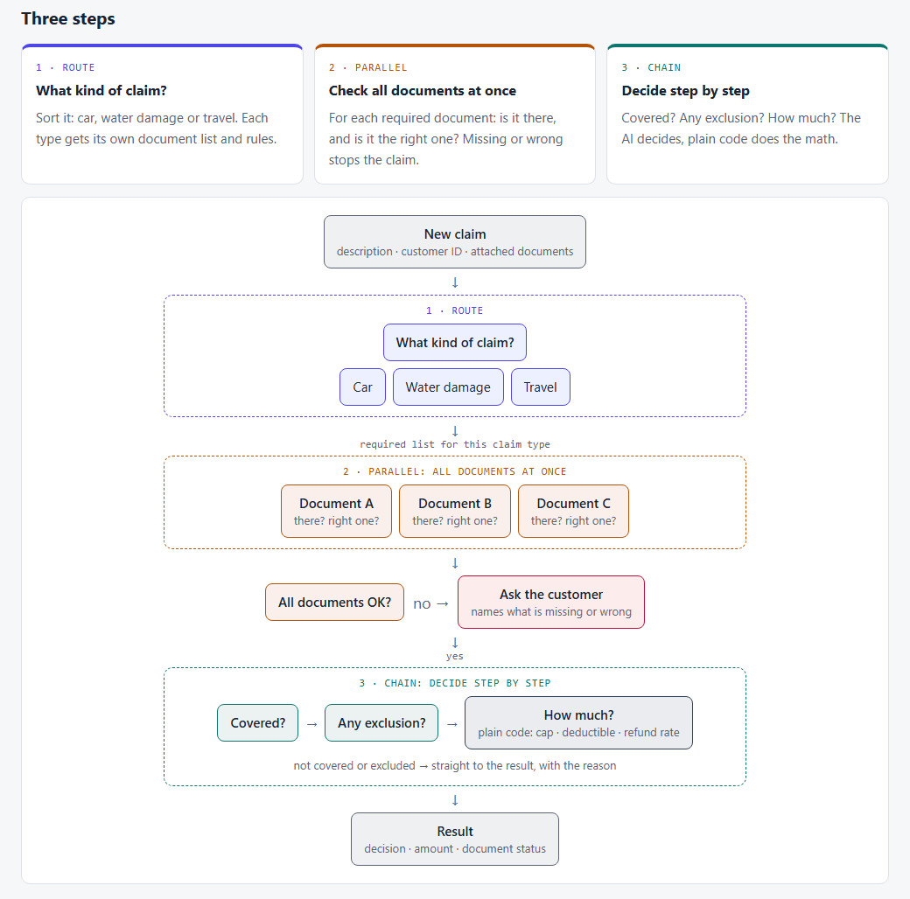
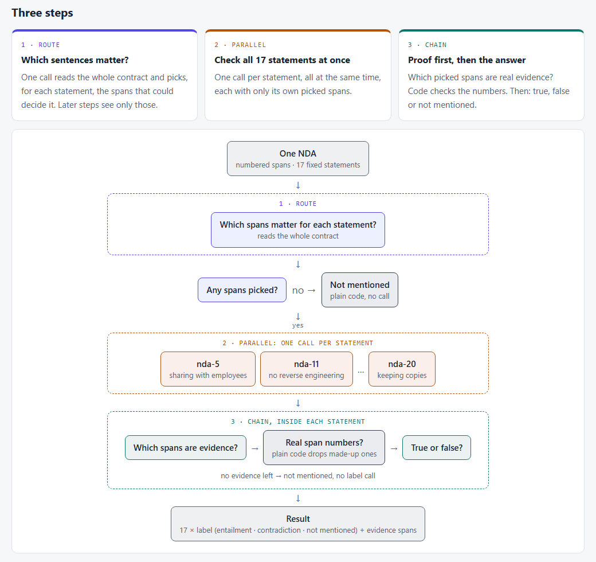

When I build something with an LLM, my first try is almost always one long prompt: here's everything, decide. It's simple, cheap and fast, and I had never really checked whether it was good enough.

Anthropic's cookbook post [Basic Multi-LLM Workflows](https://platform.claude.com/cookbook/patterns-agents-basic-workflows) points the other way. It shows three ways to split one job across several model calls: **chain** the steps one after another, run them **in parallel**, or **route** each input to a specialist prompt. Would splitting my job give better answers? And what would it cost in time, money and things that can break? I tested it twice: first on data I made up, then on real contracts.

## Three patterns, no scoreboard

Each pattern gets one small example in the post:

1. **Chain:** turn a plain-text quarterly summary into a table, in four steps (pull out the numbers, convert them, sort them, format them).
2. **Parallel:** ask how a market change affects four groups (customers, employees, investors, suppliers), all at the same time.
3. **Route:** sort three support tickets into billing, technical, account or product, then answer each with that team's prompt.

The promise sits in one line at the top: these workflows **"trade off cost or latency for potentially improved task performances."** Put simply: **pay a bit more in calls and time, get a better answer.**

The post is upfront about what it is. It calls the code **"sample implementations meant to demonstrate core concepts - not production code."** It prints the outputs and stops there. No accuracy, no token count, no cost, no timing.

It shows *how* to build each pattern. It never tests the word **"improved"**.

## Same job, built five ways

### What I wanted to know

**If I give the same job to one big prompt and to a workflow that splits it, with right answers known in advance, which one gets more right, and what does each cost?**

### Made-up claims, then real NDAs

I ran it twice, because the first data set had a weak spot I didn't like.

**Round 1: insurance claims I made up.** I know insurance claims from the inside, so I started there. A customer sends a claim: a short description, a customer ID and some attached documents. The system must decide: **pay in full**, **pay in part**, **decline** (with the reason), **ask for a document** (naming which one), or **hand it to a person**.

I wrote three short policy wordings for a made-up insurer (car, home water damage, travel), 21 customers, and two sets of 30 claims with their documents and the right answers:

- **Main set**, 30 claims. I was allowed to tune on this one.
- **Hard set**, 30 new claims I only used at the end: longer documents, extra attachments, numbers that don't agree, facts buried in long text, and routing traps (a car flooded in a parking garage is a car claim, not a home claim).

The weak spot: **I wrote both the questions and the answers.** And the documents were short.

**Round 2: real NDAs with lawyer labels.** So I looked for real data with answers someone else wrote. [ContractNLI](https://stanfordnlp.github.io/contract-nli/) from Stanford is just that: real non-disclosure agreements, each checked by lawyers against **17 fixed statements** ("the receiving party may share the information with its employees", "no reverse engineering", "copies must be returned or destroyed", and so on).

For each contract and each statement, the job is: does the contract **say it**, **say the opposite**, or **not mention it**, and which sentences prove it? Every contract is already split into numbered sentences, so the proof is a list of numbers my code can check.

- **Main set**, 30 NDAs from the dataset's dev split. Tuned on this one.
- **Held-out set**, 30 NDAs from its test split. No prompt changed once this run started.

### Five versions of one job

Each version adds one pattern to the one before, so every pattern's value shows on its own:

- **Level 0 · one big prompt.** Everything in, one answer out.
- **Level 1 · + route.** One call first decides what matters (the claim type, or the sentences for each statement). The answer prompt sees only that.
- **Level 2 · + parallel.** One call per document (claims) or per statement (NDAs), all at the same time.
- **Level 3 · + chain.** Each decision broken into steps. For claims: covered? → any exclusion? → read the numbers, and code does the math. For NDAs: find the proof first, then decide.
- **Level 0+ · one big prompt on a bigger model.** A different question: is one smarter call better than a workflow of cheaper calls?

Levels 0–3 use `gpt-6-luna` (small and cheap). Level 0+ uses `gpt-6.1-sol`. Prompt caching was on everywhere. Each level ran 3 times, because the model doesn't give exactly the same answer twice.

## Scoring the answers

| What I measure | In plain words |
|---|---|
| ✅ **Right answer** | Claims: the decision matches the key. NDAs: the label (says it / says the opposite / not mentioned) matches the lawyers' |
| 💵 **Right amount** | Claims only: the payout matches to the shekel |
| 📄 **Doc problems caught** | Claims only: a document is really missing or wrong, and the system asks for exactly that one |
| 🚨 **False doc alarms** | Claims only: the system asks for a document that was fine |
| 🔍 **Proof found** | NDAs only: of the sentences the lawyers marked as proof, how many the model named |
| ⏱️ **Time** | Seconds per claim or per contract |
| 💰 **Cost** | Dollars per 1,000 claims, or per contract |

**What Anthropic's post suggests:** more calls cost more time and money, and **may** give a better answer.

**What I expected** (my guesses before running anything):

- The **workflow would be more accurate**, especially on the tricky cases, because each step gets a smaller, cleaner piece of the job.
- It would **cost more and take longer**. Fine, if the accuracy gain was clear.
- On **real, longer contracts** the workflow had its best chance to catch up.
- If it didn't beat one prompt, that's an answer too.

## Claims first, then contracts

### Round 1 · claims, main set

30 claims × 3 repeats. I ran the workflow once, found two bugs in it, fixed them, and ran levels 1–3 again.

| Level | Decision right | Amount right | Doc problems caught | False doc alarms | Time / claim | $ per 1,000 claims |
|---|---|---|---|---|---|---|
| 0 · one prompt | **100%** | 100% | 100% | 0% | 3.0 s | $0.11* |
| 1, first try | 76% | 89% | 72% | 0% | 3.6 s | $0.13 |
| 2, first try | 60% | 80% | 33% | 28% | 5.0 s | $0.39 |
| 3, first try | 59% | 81% | 33% | 31% | 6.2 s | $0.46 |
| 1, fixed | 99% | 99% | 100% | 0% | 4.2 s | $0.12 |
| 2, fixed | 96% | 97% | 72% | 0% | 5.9 s | $0.43 |
| 3, fixed | 94% | 97% | 78% | 0% | 7.8 s | $0.53 |
| 0+ · bigger model | **100%** | 100% | 100% | 0% | 2.9 s | $1.50 |

\* A little low: it ran right after an identical run, so most of the prompt was already cached. With normal caching it's about $0.14.

- **One prompt was right every time**, even on the small model. The workflow had nothing to fix.
- **The workflow's first try was much worse (59–76%).** Both bugs were in the glue between steps, not in the model's thinking.
- **Fixed, the workflow came close (94–99%) but never beat one prompt**, at 4–5× the cost and 2.5× the time.

I tuned those fixes on these same 30 claims, so the "fixed" rows are a best case. That's what the hard set is for.

### Round 1 · claims, hard set

30 claims no prompt was tuned on.

| Level | Decision right | Amount right | Doc problems caught | False doc alarms | Time / claim | $ per 1,000 claims |
|---|---|---|---|---|---|---|
| 0 · one prompt | **94%** | 93% | 89% | 4% | 3.5 s | $0.15 |
| 1 · route | **94%** | 94% | 89% | 6% | 5.4 s | $0.20 |
| 2 · + parallel | 76% | 83% | 67% | 25% | 6.6 s | $0.55 |
| 3 · + chain | 70% | 80% | 67% | 30% | 7.7 s | $0.61 |
| 0+ · bigger model | **96%** | 96% | 100% | 1% | 3.0 s | $1.76 |

- **Now one prompt does slip, a little (94%).** It missed a buried date once, and a friend's receipt split it every time (that claim can be read two ways).
- **Routing didn't help or hurt.** It caught both routing traps, but added a call.
- **The narrow document checks hurt most: 25–30% false alarms.** A checker that sees one document alone takes it word for word: a parked car "has no driver", so the driver's license is "wrong".
- **The chain can't say "part of it".** One excluded doctor's visit declined a whole medical claim, every time.
- **The bigger model was the most accurate and the fastest**, at about 11× the small model's cost.

### Round 2 · NDAs, main set

30 NDAs × 17 statements × 3 repeats.

| Level | Label right | Proof found | Proof precision | Time / contract | $ / contract |
|---|---|---|---|---|---|
| 0 · one prompt | **83%** | 56% | 72% | 21 s | $0.0013 |
| 1 · route | 82% | 62% | 67% | 42 s | $0.0019 |
| 2 · + parallel | 78% | 54% | 72% | 23 s | $0.0024 |
| 3 · + chain | 78% | 59% | 63% | 28 s | $0.0031 |
| 0+ · bigger model | 80% | **72%** | 59% | **9 s** | $0.0090 |

- **The glue broke again, twice** (more on that below). Both were fixed before the held-out run.
- **With the glue fixed, the workflow still came in about 5 points under one prompt.**
- **The bigger model was the fastest and found the most proof, but not the most right labels.** That was new.

### Round 2 · NDAs, held-out set

30 different NDAs. **No prompt changed after this run started.**

| Level | Label right | Proof found | Proof precision | Time / contract | $ / contract |
|---|---|---|---|---|---|
| 0 · one prompt | **82%** | 61% | **73%** | 21 s | $0.0013 |
| 1 · route | 81% | 65% | 66% | 41 s | $0.0019 |
| 2 · + parallel | 77% | 55% | 69% | 21 s | $0.0024 |
| 3 · + chain | 76% | 59% | 58% | 26 s | $0.0032 |
| 0+ · bigger model | 81% | **76%** | 58% | **9 s** | $0.0091 |

- **Within 1–2 points of the main set**, same ranking. The fixes didn't over-fit.
- **The workflow's typical miss is "not mentioned" where the contract does say it.** One prompt did that about 1 time in 8. Levels 2 and 3 did it about 1 time in 5. A step that sees only the router's picks can't find a clause the router missed.
- **The bigger model has the opposite problem.** It almost never misses what the contract says (5% against 13%), but where the lawyers said "not mentioned" it answered "says it" or "says the opposite" about 1 time in 3. It reads more into the text than the labels allow.
- **"Says the opposite" stays hard for everyone.** It's rare (about 1 pair in 10) and often hides in an exception to a clause.

## Where I was wrong

- **I was wrong about the workflow.** In both rounds, one big prompt was the most accurate option on the small model, and the cheapest.
- **Splitting a job doesn't make the model smarter. It makes each call see less.** A document checker that can't see the rest of the claim, or an answer step that sees only the router's picks, fails in exactly that way.
- **Most of the workflow's mistakes lived in the glue**, not in the model: answers my code couldn't read, rules each step took too literally. Every split is one more hand-off to get right.
- **The bigger model was the easy fix on made-up claims, but not on real contracts.** There it found more proof and over-read. A bigger model is a change to measure, not an upgrade to assume.
- **What the patterns are still good for:** routing was nearly free and found more proof on NDAs; letting code do the money math kept amounts exact. Use them for those reasons, not for accuracy.

**My rule of thumb:** start with one prompt and a small test set with known answers. Split only the step you can **show** is failing, and measure again.

| Option | Use it when… | Skip it when… |
|---|---|---|
| **One big prompt** | Everything fits in one prompt and the model can read it together | It starts missing things you can name and test |
| **Route** | Each type needs very different rules, the text doesn't fit in one prompt, or you need the proof list | Everything already fits; it adds a call (and doubled the wait on NDAs) |
| **Parallel** | The checks truly stand alone, each in one short rule | A check needs the rest of the case to judge it |
| **Chain** | You need to show each step, or the math must be exact, so code does it | A step must answer yes/no where the truth is "part of it" |
| **Bigger model** | You measured it on your own labels | You assume it's better without checking |

## How far to trust this

- **Small samples:** 30 + 30 claims, and 30 + 30 NDAs out of 607. One claim is about 3 points, so small gaps between levels may be noise.
- **One model family** (OpenAI) and 3 repeats per level.
- **The claims key is my own reading.** Two claims can be read two ways. That's why round 2 exists.
- **Every NDA still fit in one prompt** (the longest is about 10k tokens). With contracts too long for one prompt, routing would be a must, and the picture could change.
- **The NDA labels are the dataset's.** A few look arguable, so part of the bigger model's "over-reading" may be fair reading.
- **Prompt caching was on everywhere**, which helps the long single prompt most. Costs are tiny at every level; the workflow's 2–5× only matters at real volume.

**Data credit.** The NDAs and labels come from **ContractNLI** (Koreeda & Manning, 2021), released under **CC BY 4.0**. The insurance claims are made up.

## Under the hood

### The claims and the NDAs

- **Claims:** three policy wordings in markdown, 21 customers with their policies, 30 main claims and 30 hard claims, each with its documents and an answer key in JSON. One ruling after the hard run (a burst water heater itself isn't covered), and the scores were re-computed from the saved runs, not re-run.
- **NDAs:** drawn with a fixed seed from the downloaded ContractNLI files: 30 from the dev split (main), 30 from the test split (held-out). Each statement's label and proof sentence numbers kept as the dataset has them. 510 contract × statement pairs per set.

### What I used

| Tool | What I used it for |
|---|---|
| **Python 3** | Everything |
| **OpenAI API**, `gpt-6-luna` and `gpt-6.1-sol` | The model calls, through one small shared helper that also counts tokens, time and cost |
| **A thread pool** | The parallel level, the same way the cookbook's `parallel()` does it |
| **pytest** | Offline tests; a shared fixture blocks every real API call during tests |
| **Claude Code** | My pair programmer: design, plan, code and review |

### The pipeline

1. `data.py` loads the set (claims, or NDAs and the 17 statements) and the answer key.
2. `prompts.py` holds all the prompt text, so one file shows what each step is told.
3. `levels.py` runs levels 0–3: the router, the parallel checks and the chain. It reads the answers from XML tags and drops sentence numbers that don't exist.
4. `rules.py` (claims only) does the business rules in plain code: which documents each claim type needs, which policy applies, and the payout math (rate, then cap, then deductible).
5. `score.py` compares each answer with the key.
6. `run.py` prints a cost estimate first, stops over budget, and saves every run as a file.
7. `report.py` builds the results file **from the run files only**. No number is typed by hand.

### Tests that guard the numbers

Offline tests, no API calls, no cost. They pin down the things that would quietly skew the numbers:

- **The answer keys are sound:** every claim's amount follows the payout rules, every NDA has all 17 statements with valid proof numbers, and the main and held-out sets share nothing.
- **The payout math:** rate, cap and deductible in the right order, to the shekel.
- **Reading the answers:** every tag the model may write is read correctly, and an answer my code can't read counts as **wrong**, not skipped.
- **Proof numbers:** a sentence number that isn't in the contract is dropped, never scored as found.
- **Scoring:** label right, F1 per label and proof found/precision checked on small hand-made cases.
- **No real calls:** the model is replaced with a fake in every test.

### Three quiet bugs

Three of my bugs, and none of them crashed anything. They just made the workflow look worse than it was:

- **A router answer my code couldn't read** (claims). The model named the claim type in a slightly different way, and my code gave up. Fix: read the router's answer forgivingly.
- **A label in the wrong tag** (NDAs). The chain's last step wrote `<contradiction>` instead of `<label>contradiction</label>`. A 2-contract smoke test caught it: 29 of 34 answers were unreadable.
- **A sentence number in a closing tag** (NDAs). The router sometimes wrote `<nda-7>11</nda-11>`. It made 1–3% of answers unreadable. I found it by calling the router 48 times on the failing contracts (8 had the slip), fixed it, and re-ran levels 1–3.

All three were format problems. Next time I'd ask the API for a **fixed answer format** (structured output) instead of XML tags, and **save the raw text of every answer my code can't read**, so I don't need extra calls to find out why.

### Get the code

Everything is on GitHub, with the data, the answer keys, the offline tests and a results file built only from real runs:

- Round 1, claims: [01-prompt-vs-workflow-claimsflow](https://github.com/hakmimi/ai-engineering-lab/tree/main/topics/01-prompt-vs-workflow-claimsflow)
- Round 2, NDAs: [02-prompt-vs-workflow-contract-nli](https://github.com/hakmimi/ai-engineering-lab/tree/main/topics/02-prompt-vs-workflow-contract-nli)
