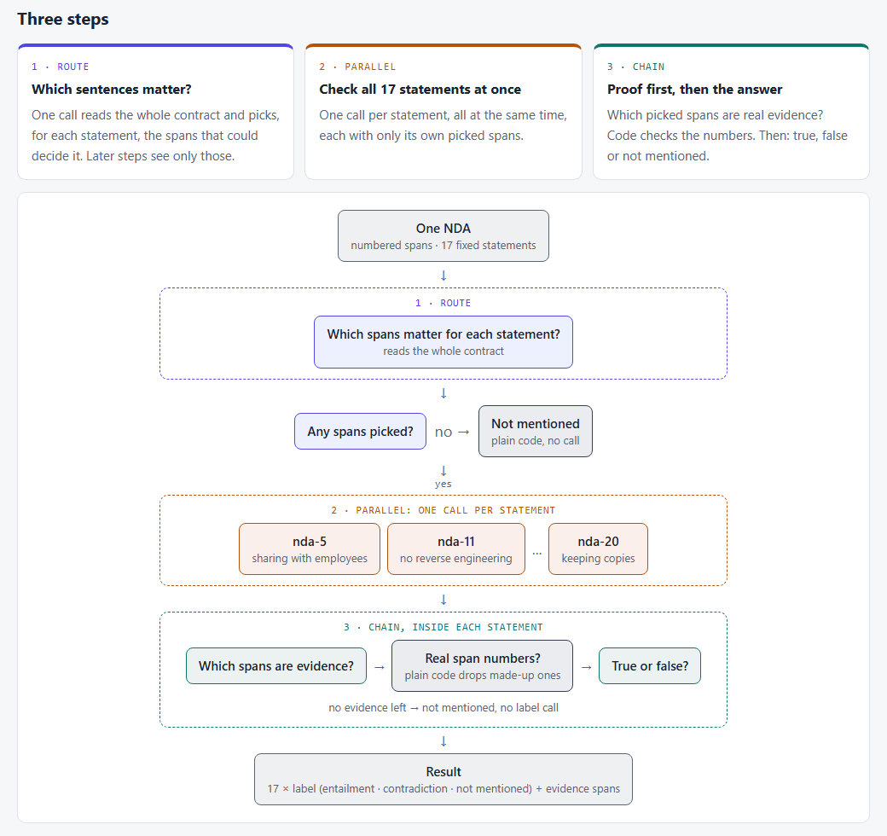

## The bottom line

**Same test, real data: the answer didn't change. On real contracts, one prompt still beat the workflow. But this time the bigger model didn't win on labels: it found much more of the proof, and also read things into the contracts that the lawyers didn't.**

Numbers from 30 held-out NDAs (510 contract × statement pairs, 3 repeats), with the main set in brackets:

| | Label right | Proof sentences found | Cost per contract | Time per contract |
|---|---|---|---|---|
| **One big prompt** (small model) | **82%** (83%) | 61% | **$0.0013** | 21 s |
| **Route, then one answer** (small model) | 81% (82%) | 65% | 1.5× | 41 s |
| **Workflow, all steps** (small model) | 76% (78%) | 59% | 2.5× | 26 s |
| **One big prompt** (bigger model) | 81% (80%) | **76%** | 7× | **9 s** |

**The lesson holds:** start with one prompt and a test set with known answers. A workflow or a bigger model is a change to measure, not an upgrade to assume.

## Why I looked into this

In [part 1](/Blog/posts/01-prompt-vs-workflow/) I asked: **when is one long prompt enough, and when does a workflow (route → parallel → chain) pay off?** On made-up insurance claims, one prompt won, and a bigger model beat splitting the job.

Part 1 had two weak spots that I named myself: **the data and the answer key were mine**, and **the documents were short**. So this part runs the same test on **real data**: real non-disclosure agreements (NDAs), with labels written by lawyers.

> **Same test, real data: does the answer change?**

## The use case: reviewing NDAs

An NDA is the most common contract a company signs, and a legal team checks the same points in every one. The public **ContractNLI** dataset turns that into a fixed list of **17 statements**: sharing with employees, sharing with third parties, return or destroy at the end, survival after the end, no reverse engineering, no solicitation, keeping copies, and so on.

For each NDA and each statement, the job is: does the contract **say it** (entailment), **say the opposite** (contradiction), or **not mention it**, and which sentences prove it?

Each contract comes already split into **numbered spans** (sentences or list items), so "evidence" is simply a list of span numbers that code can check.

**Data credit.** The contracts and labels come from **ContractNLI** (Koreeda & Manning, 2021, [stanfordnlp.github.io/contract-nli](https://stanfordnlp.github.io/contract-nli/)), released under **CC BY 4.0**.

## What I built

- **Took real data.** 60 NDAs from ContractNLI: 30 to tune on, 30 held out until the end.
- **Rebuilt part 1's five levels** on this job, so the two parts can be compared row by row:

| Level | What it adds | Calls per contract |
|---|---|---|
| **0** | One big prompt: the whole contract and all 17 statements, one answer | 1 |
| **1** | **Route** first: one call picks the sentences that matter for each statement; the answer prompt sees only those | 2 |
| **2** | **Parallel**: one call per statement, all at the same time | up to 18 |
| **3** | **Chain** inside each statement: find the evidence first (code checks the sentence numbers), then decide | up to 35 |
| **0+** | Level 0 again on a bigger model | 1 |

Levels 0–3 use `gpt-6-luna` (small, cheap). Level 0+ uses `gpt-6.1-sol`. Prompt caching was on at every level.

Every answer was scored on: **label right**, **F1** for "says it" and for "says the opposite", **evidence found** (of the sentences the lawyers marked as proof, the share the model named), **evidence precision**, **time** and **cost**.

**What I expected going in:** part 1 said one prompt wins, but real, longer contracts might let the workflow catch up, because each step gets a smaller, cleaner piece of text.

## What happened

### The main set

30 NDAs × 17 statements × 3 repeats per level.

| Level | Label right | F1 entailment | F1 contradiction | Evidence found | Evidence precision | Time / contract | $ / contract |
|---|---|---|---|---|---|---|---|
| 0 (gpt-6-luna) | **83%** | 0.86 | 0.59 | 56% | 72% | 21 s | $0.0013 |
| 1, route | 82% | 0.86 | 0.58 | 62% | 67% | 42 s | $0.0019 |
| 2, + parallel | 78% | 0.82 | 0.57 | 54% | 72% | 23 s | $0.0024 |
| 3, + chain | 78% | 0.82 | 0.55 | 59% | 63% | 28 s | $0.0031 |
| 0+ (gpt-6.1-sol) | 80% | **0.87** | 0.56 | **72%** | 59% | **9 s** | $0.0090 |

- **A small test run (2 contracts) caught the first glue bug:** level 3's label step wrote `<contradiction>` instead of `<label>contradiction</label>`, so 29 of 34 answers were unreadable. Fixed before the full run.
- **The first full run caught the second:** the router sometimes copied a sentence number into its closing tag (`<nda-7>11</nda-11>`), which made 1–3% of answers at levels 1–3 unreadable. I found it by calling the router 48 times on the failing contracts (8 had the slip), fixed it, and re-ran levels 1–3. The table shows the re-run.
- **With the glue fixed, the workflow still came in about 5 points under one prompt.** The errors were never the main gap.
- **The bigger model was the fastest and found the most proof, but not the most right labels.**

### The held-out set

30 different NDAs from the dataset's test split. **No prompt was changed after this run started.**

| Level | Label right | F1 entailment | F1 contradiction | Evidence found | Evidence precision | Time / contract | $ / contract |
|---|---|---|---|---|---|---|---|
| 0 (gpt-6-luna) | **82%** | 0.86 | **0.63** | 61% | **73%** | 21 s | $0.0013 |
| 1, route | 81% | 0.85 | 0.62 | 65% | 66% | 41 s | $0.0019 |
| 2, + parallel | 77% | 0.80 | 0.62 | 55% | 69% | 21 s | $0.0024 |
| 3, + chain | 76% | 0.79 | 0.59 | 59% | 58% | 26 s | $0.0032 |
| 0+ (gpt-6.1-sol) | 81% | **0.88** | 0.61 | **76%** | 58% | **9 s** | $0.0091 |

- **The held-out numbers match the main set within 1–2 points.** The fixes didn't over-fit, and the ranking is the same.
- **Contradictions stay hard for everyone** (F1 0.59–0.63). They are rare (about 1 pair in 10) and often hide in an exception to a clause.
- **The hardest statement for the small model was "no licensing"** ("the agreement grants no rights to the information": 48–57% right). It's usually implied, not written out, and the lawyers' labels expect you to see it.

## Why the workflow lost

- **A step only sees the sentences the router picked.** When the router misses the clause, the step honestly answers "not mentioned". Of the pairs the lawyers marked as "the contract says so", one prompt answered "not mentioned" about **1 time in 8**; levels 2 and 3 did it about **1 time in 5**.
- **The glue broke again, twice.** A label written in the wrong tag, and a router that copied a sentence number into its closing tag. Both were fixed on the main set before the held-out run, but it's the same lesson as part 1: most of the mistakes live in the hand-offs, not in the model's thinking.

## Why the bigger model didn't win

The bigger model has the opposite problem. It almost never misses what the contract says (5% of those pairs, against 13% for the small model), but on pairs the lawyers marked "not mentioned" it answered "supports" or "contradicts" about **1 time in 3** (the small model with one prompt: about 1 in 6). It reads more into the text than the labels allow.

Its weakest statements were "all confidential information must be expressly identified" and "copies may be made" (both 41% right). Some of that may be fair reading, but the labels are the labels.

## When I'd use what

What held from part 1, and what changed on real contracts:

| Option | Part 1 (made-up claims) | Part 2 (real NDAs) | So… |
|---|---|---|---|
| **One big prompt** | Best on the small model | **Still best** on labels, cheapest | Start here. Every NDA fit in one prompt. |
| **Route** | Free, didn't help | Nearly free on labels, **found more proof**, but **2× slower** | Use it when you need the evidence list, or when documents don't fit in one prompt. |
| **Parallel** | Hurt: each check saw too little | Hurt: each check saw only the router's picks | Only for checks that truly stand alone. |
| **Chain** | Hurt: steps lost the full picture | Hurt the most on labels, lowest evidence precision | Use it for auditability, not for accuracy. |
| **Bigger model** | Best on hard claims | **Best at finding proof**, fastest, but **over-reads**; labels level with the small model | Measure it before you switch. Tell it to stay literal if the labels are literal. |

**The explanation behind it:** the same as part 1. Splitting a job makes each call see less. On real contracts the miss shows up in one place: a clause the router didn't pick is a clause the next step can never find.

## Caveats

- **Small sample:** 30 + 30 NDAs out of 607, 3 repeats per level, one model family (OpenAI).
- **Contradiction is rare** (about 1 pair in 10), so its F1 moves a few points between runs.
- **Every NDA still fit in one prompt** (the longest is about 10k tokens). Routing here cut the text by choice, not by need. With contracts too long for one prompt, routing would be required, and the picture could change.
- **The labels are the dataset's, not mine.** A few look arguable (especially the implied ones, like "no licensing"), and part of the bigger model's "over-reading" may be fair reading.
- **The two glue fixes were tuned on the main set.** The held-out set had at most 1 unreadable answer per repeat.

## What I'd improve next time

- **Save the raw text of every answer the code can't read.** Both glue bugs took extra calls to diagnose.
- Ask for a **fixed answer format** (structured output) instead of XML tags. That would likely have prevented all three format bugs in this series.
- Let a step see **the router's picks plus the whole contract**, or ask the router to pick generously by clause, not by sentence.
- Tell the bigger model to **stay literal** ("not mentioned unless the contract says it") and measure again.
- Run all **123 test NDAs**, and try a second model family.

## The code

Everything is on GitHub: [ai-engineering-lab / 01-prompt-vs-workflow-contract-nli](https://github.com/hakmimi/ai-engineering-lab/tree/main/topics/01-prompt-vs-workflow-contract-nli). It has the full pipeline in Python, the 60 NDAs with their labels, offline tests, and a results file built only from real runs.
