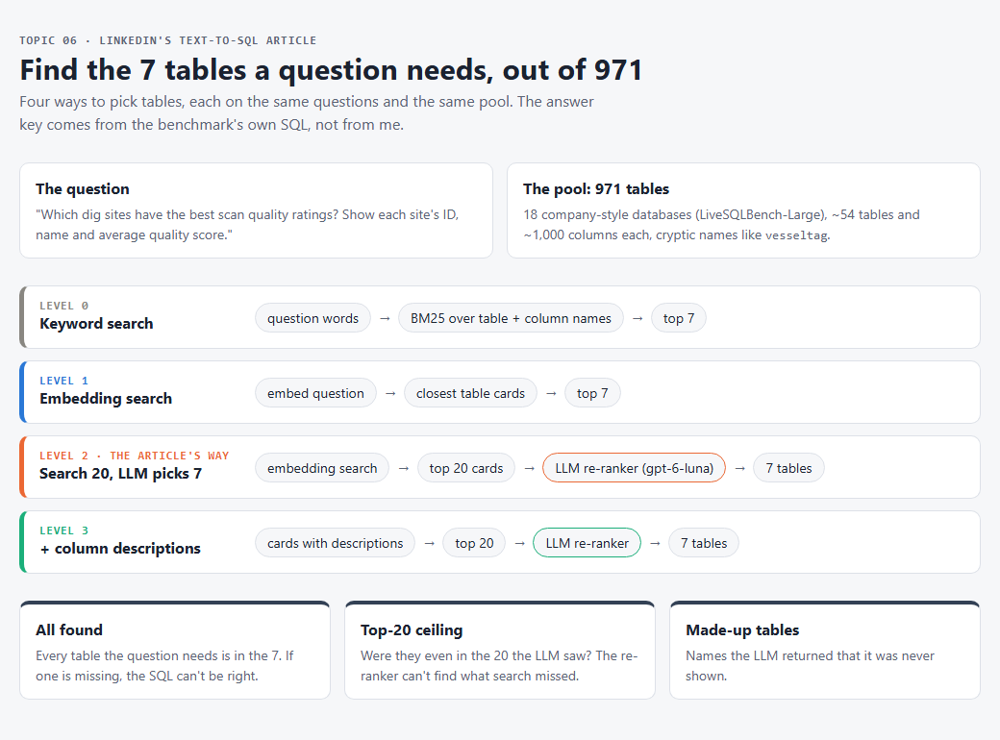
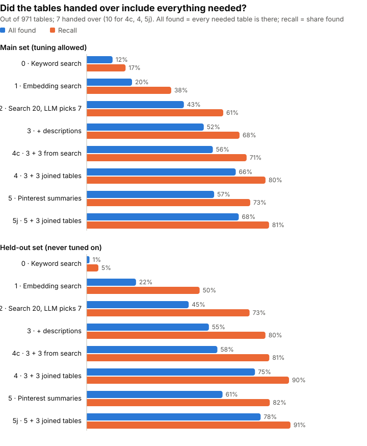
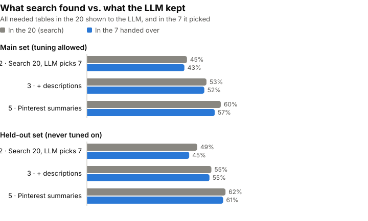
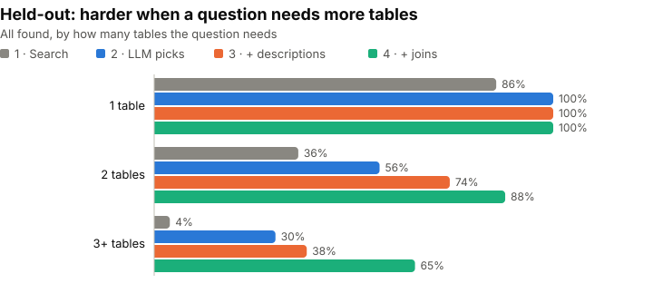
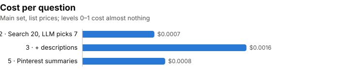

Ask a data bot "which dig sites have the best scan quality?" and before it writes a single line of SQL, it has to answer a harder question: out of hundreds of tables, which ones hold the answer? Get that wrong and the SQL is wrong, however clean it looks.

LinkedIn wrote about exactly this in [Practical text-to-SQL for data analytics](https://www.linkedin.com/blog/engineering/ai/practical-text-to-sql-for-data-analytics), the story of SQL Bot, their tool for asking data questions in plain English. Their warehouse has millions of tables, and they say finding the right ones is the hard part, harder than writing the query.

## Two companies, one claim

LinkedIn's table finding works in three steps:

1. **Search.** Turn the question and every table into embeddings, and take the **20** closest tables.
2. **An LLM picks.** Show those 20 to a model and let it choose the **7** a query needs.
3. **Write SQL** with only those 7.

They also say two things make the search better: **descriptions** of tables and columns, and **example queries**. Their graph (Figure 6) shows table recall going up as each piece is added. But it has no numbers on it. Their test set is about 130 private questions, and they don't say which models they use.

[Pinterest describes the same pattern](https://medium.com/pinterest-engineering/how-we-built-text-to-sql-at-pinterest-30bad30dabff), with one twist: before anything else, an **LLM writes a short summary of every table**, and the search runs on those summaries. They say their table search hit rate was 40% before they added table documentation to the search. It got better as they gave the documentation more weight, but they don't give the final number.

What it implies: **you can point an LLM at a huge warehouse, and with a search step in front of it, it will find the tables your question needs.**

Neither company shows how often that's true on questions anyone else can check. That's what I wanted to see.

## 971 tables, 332 questions, one answer key

### What I'm asking

**When a warehouse has hundreds of tables, does "search 20, let an LLM pick 7" find every table a question needs? And do descriptions or LLM summaries help?**

### Where the questions and the answers come from

I needed three things: a big, messy schema, real questions, and an answer key I didn't write.

- **The tables:** [LiveSQLBench-Large](https://huggingface.co/datasets/birdsql/livesqlbench-large-v1), from the BIRD team. 18 company-style databases, **971 tables** in all, about 1,000 columns per database. The names are messy on purpose: in the archaeology database, `vesseltag` is the project name and `fundflux` is where the money came from. Every column also has a one-line description written by the BIRD team.
- **The questions:** 332 analyst questions that come with the benchmark.
- **The answer key:** the BIRD team wrote a correct SQL query for each question. Snowflake's [SQL-Schema-Retrieval](https://huggingface.co/datasets/Snowflake/SQL-Schema-Retrieval) release parsed those queries into "this question needs these tables". I use that list. I never see the SQL itself.

I put all 971 tables in one pool, like one big warehouse. Every question searches all of them.

**Two sets.** I split the 18 databases in half with a fixed seed:

- **Main set:** 173 questions from 9 databases. I was allowed to look at these and adjust things.
- **Held-out set:** 159 questions from the other 9. New databases, new topics, never used for tuning.

The held-out questions turned out harder: they need 3.1 tables on average, against 2.3 in the main set. So I compare levels within a set, not one set against the other.

### Eight ways to pick the tables

Every level hands **7 tables** to the (imagined) SQL writer, except levels 4, 4c and 5j, which hand over 10.

- **Level 0 · Keyword search.** Match the question's words against table and column names. Free.
- **Level 1 · Embedding search.** Take the 7 closest tables by embedding.
- **Level 2 · LinkedIn's way.** Embedding search for 20, then an LLM picks 7.
- **Level 3 · + descriptions.** Same, but every table card also carries its column descriptions.
- **Level 4 · + joined tables.** Level 3's 7 picks plus 3 tables connected to them by a foreign key. This is my own add-on, in the spirit of LinkedIn's "common joins".
- **Level 4c · the control for level 4.** Level 3's 7 picks plus search ranks 21 to 23: the closest tables the LLM never saw. Also 10 tables, and also from outside the 20, so if level 4 wins, it's the joins, not just "more tables".
- **Level 5 · Pinterest's way.** An LLM first writes a summary of each table from the same descriptions, using Pinterest's own prompt. Search and pick then use the summaries.
- **Level 5j · the two best together.** Level 5's 7 picks plus 3 joined tables, the same way as level 4. I added this after the first results, because it was the obvious next question.

## Keeping score

- **All found.** Out of all questions, how many got **every** table they need. This is the one that matters: if one table is missing, the SQL can't be right.
- **Recall.** What share of the needed tables were found. Kinder than "all found", but it hides the missing piece.
- **Top-20 ceiling.** Were all the needed tables at least in the 20 the LLM was shown? The LLM can't pick a table the search never brought.
- **Made-up tables.** Answers where the LLM named a table it wasn't shown.
- **Cost and time** per question.

**What the articles suggest:** each step helps. The LLM pick beats plain search, descriptions help, and summaries help a lot.

**What I expect:** honestly, I didn't have a guess. So Claude wrote down its guesses before any paid run (held-out set, all found): embedding search about 15%, LLM pick about 30%, with descriptions about 40%. Its bet was that the top-20 ceiling would be the bottleneck, because tables that are only there for a join don't look like the question.

## Search was the weak link, not the LLM

### Main set first

On the 173 main-set questions, plain embedding search got every needed table into its 7 only **20%** of the time. Keyword search got 12%.

LinkedIn's way, search 20 and let the LLM pick 7, more than doubled that to **43%**. Adding column descriptions to the table cards took it to **52%**. Pinterest's summaries did a bit better at **57%**.

Adding 3 tables joined to the picks by a foreign key (level 4) gave the biggest gain after the LLM pick itself: **66%**. The control, the next 3 tables from search (4c), only reached 56%. So it's the joins that help, not just handing over more tables.

Putting the two best ideas together, Pinterest's summaries plus 3 joined tables (5j), gave the best score: **68%**.

### Then the held-out set

The held-out set, with 9 databases I never tuned on, tells the same story, a little higher:

- embedding search: **22%**
- search 20 → LLM picks 7: **45%**
- \+ descriptions: **55%**
- Pinterest summaries: **61%**
- level 3 + the next 3 from search (the control): **58%**
- level 3 + 3 joined tables: **75%** (recall 90%)
- Pinterest summaries + 3 joined tables: **78%** (recall 91%)

Level 5j beats level 4 by only 3 points, about 5 questions, so I'd call those two a tie.

So LinkedIn's claim holds on questions anyone can check. Each step helps, and the LLM step is worth a lot.

### What the LLM was shown vs. what it kept

This was the surprise. The LLM almost never dropped a table it needed. When all the needed tables were in the 20 it was shown, it nearly always kept them all. On the held-out set: 49% in the 20, 45% in the 7 (level 2). 55% and 55% (level 3). 62% and 61% (level 5).

So the limit is **search**: in about 4 questions out of 10, at least one needed table never made it into the 20. That's why level 4 helps so much. Its joined tables can come from outside the 20, so it beats the top-20 ceiling by far: 75% against 55%. Three more tables from search beat it only a little (58%).

### Questions that need more tables

One-table questions are easy: 86% with plain search, 100% once the LLM picks at levels 2 to 4 (95% with Pinterest's summaries). The trouble is questions that need **3 or more** tables, which is most of the held-out set (102 of 159). Plain search finds all of them only 4% of the time. LLM pick 30%, descriptions 38%, Pinterest summaries 48%. Joins take it to **65%**, and summaries plus joins (5j) to **70%**.

The main set shows the same shape, a bit lower: on 3+ table questions it goes 17% → 24% → 43% (levels 2, 3, 4).

### What it costs

The LLM step costs well under a cent per question at `gpt-6-luna`'s list prices. Level 2: **$0.0007**. Level 3: **$0.0016**, because description cards are long. Pinterest's summary cards are short, so level 5 costs **$0.0008** and still beats level 3. The summaries themselves cost **$0.19 once**, for all 971 tables.

The LLM call takes about 10 seconds per question. Levels 4 and 4c reuse level 3's answers, and 5j reuses level 5's, so they add no cost and no time.

The whole topic, smoke runs included, cost **$2.21**.

### What I expected vs. what happened

Claude's guesses for the held-out set, written down before any paid run:

- Embedding search: guessed about 15%, got **22%**.
- Top-20 ceiling: guessed about 40%, got **49 to 55%**.
- LLM picks 7: guessed about 30%, got **45%**.
- With descriptions: guessed about 40%, got **55%**.
- The bet, "the top-20 ceiling is the bottleneck": **that one held.** The LLM kept nearly everything it was shown.

Every number came in higher than the guesses. The shape was right, but the guesses underrated how well the LLM picks.

## If I were building a SQL Bot

- **The "search, then LLM picks" pattern is worth it.** It about doubles the questions that get every table, for less than a tenth of a cent each.
- **Spend your effort on search, not the picker.** The LLM almost never drops a table it's shown. Every table search misses is a question you lose.
- **Follow the foreign keys.** After the LLM pick itself, adding 3 joined tables was the biggest gain (55% → 75% held-out), at no cost. Three more tables from search only got 58%. On top of Pinterest's summaries it reached 78%, the best of all. Tables that are only there for a join don't look like the question, so search won't find them. The schema can.
- **Pinterest's summaries are a cheap upgrade.** Shorter cards than full descriptions, better search, half the price per question.
- **Count "all found", not recall.** At level 3, recall on the held-out set was 80%, which sounds great. But only 55% of questions got every table, and a query with one table missing is wrong.

## What this test can't tell you

- **971 tables isn't millions.** LinkedIn's warehouse is far bigger. With more tables, search gets harder, so the ceiling would likely be lower than here.
- **The descriptions are good.** The BIRD team wrote a description for every column, and some include example values. Many real warehouses have nothing like this. Pinterest's summaries were made from these same descriptions, so here they only change the form, they don't add knowledge.
- **No example queries.** LinkedIn and Pinterest both use past queries to help search. This benchmark has none, so Pinterest's prompt got "(none available)" there.
- **The model is `gpt-6-luna`, the embeddings are `text-embedding-3-small`.** LinkedIn doesn't name their models. Other models might pick differently.
- **The answer key comes from the gold SQL.** If a question could also be answered with other tables, I count that as a miss.
- **Some questions can't be fully found with 7 tables.** One question in each set needs 8. Only levels 4, 4c and 5j, with 10 tables, could get it all.
- **I knew level 4 should help before I ran it.** Before building it, I checked how often the needed tables were linked by a foreign key, on both sets. That's why I built it, and it's also why I added the 4c control. Level 5j came after I'd seen all the other results, and it has no control of its own.
- **No spot check.** The author decided to go ahead without checking 20 questions by hand.
- **A few unreadable answers.** Up to about 1 per run of 159, the LLM's answer had no complete list. These count as misses. I didn't keep their raw text.
- **159 questions is not a lot.** One question is about 0.6 points, and the one-table group on the held-out set has only 21 questions. Small gaps between levels may be noise.

**Data credit.** Questions, schemas and descriptions come from **LiveSQLBench-Large** by the BIRD team, CC BY 4.0. The table answer key comes from Snowflake's **SQL-Schema-Retrieval**. See [`data/NOTICE.md`](https://github.com/hakmimi/ai-engineering-lab/blob/main/topics/06-text-to-sql-table-retrieval/data/NOTICE.md) for what I took and changed.

## How it's built

### The data

- **Sources:** LiveSQLBench-Large-v1 at commit `a418e10` and Snowflake's SQL-Schema-Retrieval (`livesqlbench_large_table`) at commit `e60c65c`, both on Hugging Face.
- **Tables:** every `CREATE TABLE` block becomes a table with its columns, types and descriptions. Table ids look like `archeology_large.scans`.
- **Foreign keys:** 1,065 links between tables, from the same schema files. Level 4 uses them.
- **Sets:** the 18 databases split 9 and 9 with seed 2026. Main: 173 questions. Held-out: 159.
- **The answer key** (`key.json`) is built from Snowflake's release and is never committed. The levels never see it. I never download the gold SQL, which the BIRD team keeps gated.

### The tools

| Tool | What I used it for |
|---|---|
| **Python 3** | Everything |
| **OpenAI** `text-embedding-3-small` | Embeddings for tables and questions, cached on disk |
| **OpenAI** `gpt-6-luna` | Picking 7 of 20 (levels 2, 3, 5) and writing the table summaries (level 5), through the shared helper [`shared/llm.py`](https://github.com/hakmimi/ai-engineering-lab/blob/main/shared/llm.py) that counts tokens, time and cost |
| **My own BM25** | Level 0's keyword search, a few lines in `search.py` |
| **pytest** | Offline tests. A shared fixture blocks every real API call |
| **Claude Code** | My pair programmer: design, plan, code, and a fresh review of the whole branch before any money was spent |

### Step by step

1. `build_data.py` downloads both datasets at their pinned commits, reads the schemas and descriptions, splits the databases and writes `data/`.
2. `summarize.py` writes one summary per table with Pinterest's prompt (level 5 only), once.
3. `levels.py` runs a question through a level. Levels 2, 3 and 5 send 20 table cards to the LLM and ask for the 7 a query needs, in `<tables>` tags. Only tables it was shown count. A table it wasn't shown is counted as "made up". If it names fewer than 7, the rest are filled from the search list, and that's recorded.
4. `run.py` prints a cost estimate, refuses to start if the estimate is over budget, stops at the $5 topic ceiling, and saves every repeat to a run file.
5. `report.py` builds `results.md` and the graphs **from the run files only**. Levels 4 and 4c are built there from level 3's saved answers, and 5j from level 5's, with `joins.py`. `next_search.py` saves search ranks 21 to 23 for the 4c control, from the cached embeddings only.

### The tests

75 offline tests, no API calls. The ones that guard the numbers:

- **No leaks:** the answer key sits in its own file that is never committed, question ids give nothing away, and the main and held-out sets never share a database.
- **The schema reader keeps every column,** including the tricky ones below.
- **Reading the LLM's answer:** only the last complete `<tables>` list counts, a cut-off answer is an error, a wrong database name isn't quietly matched to another table, and every fill from search is recorded.
- **Fair scoring:** an unreadable answer is a miss. An API outage is left out and counted apart.
- **Cost:** per-question cost comes from repeat 1 only, and the estimate includes every paid call.
- **Level 4:** joined tables are ranked the same way every time, and 4c adds search ranks 21 to 23, never a table the LLM saw.

### What went wrong on the way

Before spending money, I had a fresh reviewer go through the whole branch. It found things that would have quietly changed the results:

- **Cut-off answers.** The model counts its hidden reasoning against the answer length limit. With a limit of 600 tokens, some answers stopped before the list was closed. I raised it to 2,000, and a list that never closes now counts as an error, not as "picked nothing".
- **Hidden fills.** When the LLM named fewer than 7 tables, the code filled the rest from search without saying so. That could make the LLM look better than it is. Now every fill is counted. It turned out to be rare (about 1% of answers).
- **Columns lost from the schema.** My schema reader took any column whose name started with "check" or "unique" for a constraint, and dropped it. I fixed the reader, rebuilt the data and re-ran level 0.
- **Cost diluted by the cache.** Repeats 2 and 3 send the same prompts and get a cache discount. Averaging all three made the LLM step look cheaper than a first call really is.

Two more came up later:

- **A cost estimate that missed the LLM.** I caught this one myself: the estimate for level 5 left out the LLM call and said $0.01 instead of $0.83. The runner trusts the estimate to decide whether to start, so a test now checks it.
- **A control that couldn't win.** A second fresh review, of levels 4 and 5, found that my first 4c took its 3 extra tables from inside the 20: tables the LLM had already seen and turned down. They held a needed table in 1 of 519 main-set answers. So "4c did nothing" was built in. Now 4c takes search ranks 21 to 23, outside the 20 like most joined tables. It went from 55% to 58% on the held-out set. Joins still win clearly, but now the comparison is fair.

None of these would have crashed anything. They would just have made the numbers wrong.

### The code

Everything is on GitHub: [ai-engineering-lab / 06-text-to-sql-table-retrieval](https://github.com/hakmimi/ai-engineering-lab/tree/main/topics/06-text-to-sql-table-retrieval). It has the data builder, all eight levels, Pinterest's summary prompt, the runner with its cost guard, and 75 offline tests.
