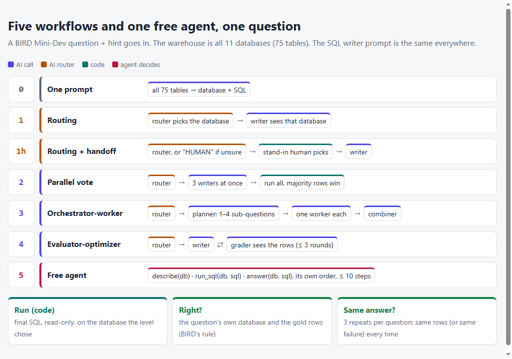
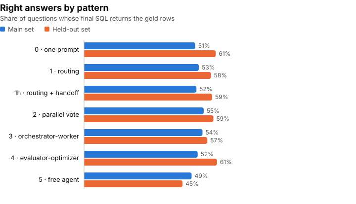
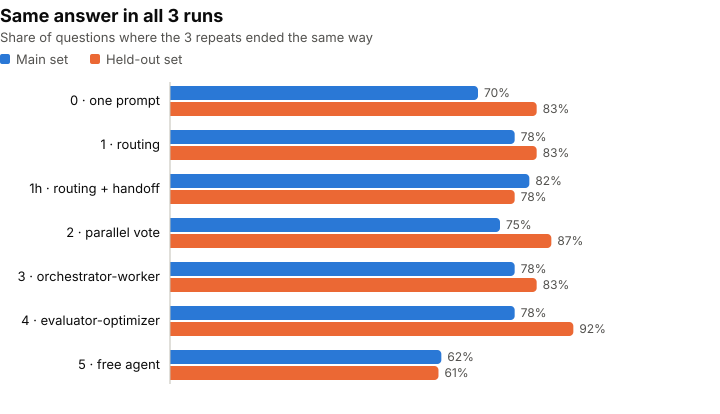
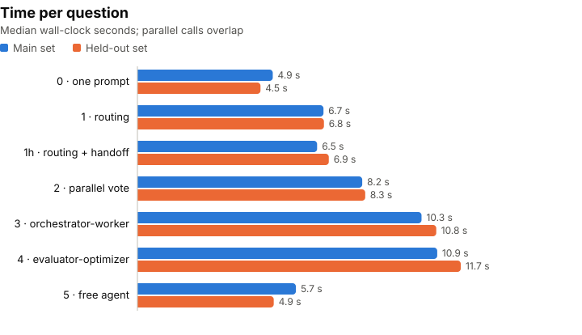
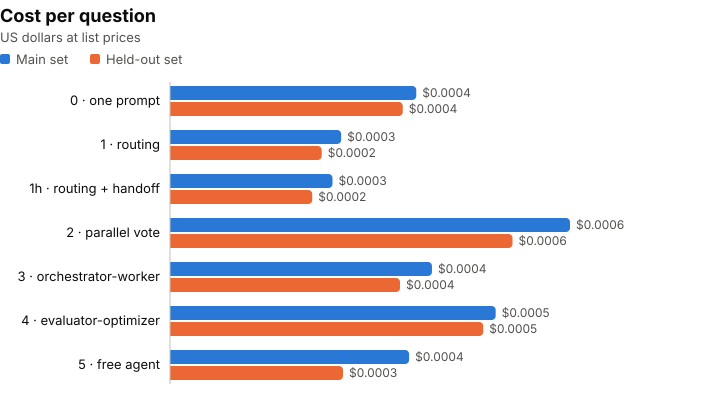

"Start with a workflow, use a free agent only when you must." I've read that advice so many times that I'd stopped asking for the proof. Safe Software's guide, [AI Agentic Workflows: Tutorial & Best Practices](https://fme.safe.com/guides/ai-agent-architecture/ai-agentic-workflows/), says it plainly: "In most cases, an agentic workflow will provide better reliability and reproducibility than an AI agent."

The guide walks through five patterns, with partial LangGraph code. It shows no numbers. So I built all five, plus a free agent with tools, on one task where someone else wrote the answer key, and ran each one three times.

## Five patterns, one promise

The guide's patterns, in my words:

1. **Single agent:** one model call does the whole job.
2. **Routing and handoff:** a first call decides where the work goes. It can also hand off to a person.
3. **Parallelization:** several calls work at once; the results are joined or voted on.
4. **Orchestrator-worker:** a planner splits the task, and a worker takes each part. The number of parts is decided at run time.
5. **Evaluator-optimizer:** one call writes, another grades and sends feedback, until it passes.

Against these it sets the **AI agent**: a model with tools that decides its own steps. The guide's promise is that the fixed workflows are more **reliable** (right more often) and more **reproducible** (the same answer each time). It also says agents "generally increase the latency" and use more tokens.

If that's true, it's a clear rule for anyone building with LLMs: don't hand the model the steering wheel unless the task truly needs it.

## 11 databases, 120 questions, 7 ways to answer

### The question

**On the same questions, model and SQL writer, does a fixed workflow beat a free agent on right answers, on giving the same answer every run, and on cost and time?**

### The data

The task is **text-to-SQL**: turn a question into a query. The questions come from [BIRD](https://bird-bench.github.io/) Mini-Dev: real SQLite databases (schools, Formula 1, a bank, superheroes, chemistry and more). Each question has a hint and a correct query written by the dataset's authors. A query is **right** when it returns the same rows as theirs.

I put all **11 databases (75 tables)** in one "warehouse", so every pattern first has to find the right database.

The same 60 + 60 questions as [topic 05](https://github.com/hakmimi/ai-engineering-lab/tree/main/topics/05-evaluator-optimizer-text-to-sql) and [topic 07](https://github.com/hakmimi/ai-engineering-lab/tree/main/topics/07-text-to-sql-where-it-breaks):

- **Main set:** 60 questions on 6 databases. This is where I wrote and checked the prompts.
- **Held-out set:** 60 questions on 5 other databases. Run once at the end, nothing changed.

### The levels

Every SQL writer in the workflows uses the **same writer prompt** (topic 05's). The level 3 combiner and the level 5 agent have their own prompts. Wherever a database is shown in full, it is the same schema text: `CREATE TABLE` plus 3 example rows per table. Each level changes one thing.

| Level | Pattern | What it does | AI calls |
|---|---|---|---|
| **0 · one prompt** | single agent | One call sees all 75 tables and answers with the database and the SQL | 1 |
| **1 · routing** | routing | A router reads one line per table (`database.table: columns`) and names the database; a writer sees only that database | 2 |
| **1h · routing + handoff** | handoff to a person | Same, but the router may answer HUMAN when unsure; a stand-in person then picks the right database | 2 |
| **2 · parallel vote** | parallelization | Router, then 3 writers at once; the largest group whose queries return the same rows wins | 4 |
| **3 · orchestrator-worker** | orchestrator-worker | Router, then a planner splits the question into 1–4 sub-questions, one worker each, and a last call combines them | 3+ |
| **4 · evaluator-optimizer** | evaluator-optimizer | Router, then topic 05's loop: writer + grader who sees the result rows, up to 3 rounds | 3+ |
| **5 · free agent** | AI agent | One model with three tools: `describe` a database, `run_sql`, `answer`. It decides the steps, at most 10 | 1–10 |

The free agent starts with the **same table list as the router**, so neither starts knowing more.

## Right, steady, fast, cheap

- **Right:** the final query returns the correct rows. Averaged over 3 repeats.
- **Same answer 3/3:** all 3 repeats end the same way (same rows, or the same failure). This is the guide's "reproducibility".
- **Right 3/3:** right in all 3 repeats.
- **Seconds per question:** the median wall-clock time. Parallel calls overlap.
- **Cost per question**, at list prices.
- **API errors** are counted apart, never scored as wrong.

The model is `gpt-6-luna`, the cheap model I use across this series, in every role.

**What the article suggests:** workflows are right more often and more repeatable; the agent is slower and costs more.

**What I expected** (written before any run): the free agent is **less right and less stable**. Workflows win on right answers and on giving the same answer every run.

## The agent lost, mostly to one trap

Full tables: [`results.md`](https://github.com/hakmimi/ai-engineering-lab/blob/main/topics/09-agentic-patterns-bird/results.md). Every number below comes from the run files.

**Headline:** on the held-out set the free agent was right **45%** of the time; every workflow was at **57–61%**. On the main set the gap was small. But most of the held-out gap traces back to one mistake the agent never checked for.

### 1 · On new databases, every workflow beat the agent

On the **held-out** set the workflows beat the agent by **11 to 16 points**. One question is worth 1.7 points, and repeats of the same level moved by up to 7 points, so this gap is real.

On the **main** set the agent was at **49%** and the workflows at **51–55%**: gaps of 2 to 6 points. Repeats there moved by up to 5 points, so most of that is noise.

### 2 · The agent was also the least steady

The agent gave the same answer in all 3 runs for **62%** (main) and **61%** (held-out) of questions. The workflows: **70–82%** on main and **78–92%** on held-out. It was also right 3 times out of 3 on only **32%** of held-out questions, against **52–58%** for the workflows.

The steadiest of all was the **evaluator-optimizer** on the held-out set: the same answer on **92%** of questions, and no failing SQL at all.

### 3 · Why: it used names that don't run, and never ran the ones that failed

The agent's table list shows names as `database.table`, like `superhero.superhero`. That's a label, not something SQLite understands. On the held-out set, **35** of the agent's final queries used that form and failed with "no such table". On the main set, **15**. No workflow ever did this: the router only names a database, and the writer sees plain `CREATE TABLE` text.

The agent could have caught it. It had a `run_sql` tool for exactly this. But it mostly didn't look:

| Before answering, the agent… | Main | Held-out |
|---|---|---|
| answered at once | **66%** of answers | **77%** of answers |
| described a database first | 26% | 21% |
| ran a test query first | 8% | 3% |

It used **1.4–1.5 steps** on average out of 10, and never hit the cap. The freedom to check was there; it wasn't used. Of the **15** (main) and **35** (held-out) answers that failed on these names, the agent had run **0** with `run_sql` before answering.

So I asked: what if those names had worked? I re-ran the agent's **stored** queries offline, with each database also reachable under its own name. No model calls, nothing re-asked. On the held-out set, **29 of the 35** failed queries would have been right. The agent would score **61% instead of 45%**, and give the same answer **83% of the time instead of 61%**. That's level with the workflows. On the main set: **51% instead of 49%**, same answer **77% instead of 62%**.

This what-if is not the result. The result is the 45%. But it shows where most of the held-out gap sits: in one error that no workflow made.

### 4 · The patterns barely fired

What the patterns actually did, on both sets:

- **Handoff:** the router never said HUMAN. **0%** handed off.
- **Orchestrator:** the planner always kept the question whole: **1.0** sub-questions on average. Level 3 became level 1 with one extra call.
- **Evaluator-optimizer:** **1.08** (main) and **1.16** (held-out) rounds. The grader passed the first query most of the time.
- **Parallel vote:** **2.7–2.8** of 3 writers agreed with the winner. Three tries mostly gave one answer.

And the plain **one prompt** (level 0) was as good as any of them: **51%** on main, **61%** on held-out. Every level picked the right database for **100%** of answers, so routing had nothing to fix here.

### 5 · The agent wasn't slow

The guide says agents add latency. Here the agent was one of the **fastest**: **5.7 s** (main) and **4.9 s** (held-out) per question, next to **4.5–4.9 s** for one prompt and **10–12 s** for the orchestrator and the evaluator. It took **1.4–1.5** steps per question on average.

Cost tells the same story. Everything cost **less than a tenth of a cent** per question. The agent was on the cheap side; the parallel vote, with 4 calls, was the most expensive. The whole topic, smoke runs included, cost about **$1**.

### What I expected vs. what happened

| I expected | What happened |
|---|---|
| The free agent is less right | **Yes on held-out** (45% vs 57–61%); on main the gap is within noise |
| The free agent is less stable | **Yes on both** (61–62% same answer vs 70–92%) |
| (The article) the agent is slower | **No.** It was among the fastest, because it rarely took a second step |
| (The article) each pattern helps | **Not here.** The handoff and the planner never kicked in; level 0 was as good as any |

## What I'd tell someone choosing

- **The guide's rule held here.** The workflows won on held-out data, and they were steadier everywhere. Most of the held-out gap sits in one error the workflows never made. Their **structure** kept them away from it: the router only outputs a database name, and the writer only sees real table text. The free agent had room to make that mistake.
- **Freedom to check is not checking.** Given a test tool and 10 steps, the agent answered at once in two out of three cases. If you build an agent, measure what it actually does with its tools, not just its final answer.
- **Measure "the same answer twice" on its own.** It moved more than accuracy did: the agent lost up to **31 points** on it against the evaluator-optimizer. A system that's right 55% of the time but differently each run is hard to trust.
- **A pattern only helps if its trigger happens.** The handoff and the planner never fired on these questions. Before adding a pattern, check that the failure it fixes actually shows up in your data.
- **Look at the failures, not just the score.** The headline gap here came down to one error message repeated 35 times.

## What this doesn't show

- **The agent's trap is partly my setup.** It got the same `database.table` list as the router, a choice made so both start equal. I didn't test another list format, or native function calling with a separate database field. I didn't fix the prompt and run again: that would be tuning after seeing the held-out results. The offline what-if is reported next to the real numbers, not instead of them.
- **The what-if is not a re-run.** It runs the agent's stored queries with the prefix allowed. It does not show what an agent with a fixed prompt would do: that was not run.
- **Text tools, not function calling.** The agent calls tools by writing `<tool>…</tool>` in its answer, so every level goes through the same plain model call. Native tool calling was not tested.
- **One cheap model.** Every role is `gpt-6-luna`; the guide uses GPT-4o. No other model was tested.
- **One task, an easy route.** 11 very different databases make routing easy. A harder warehouse or longer questions were not tested.
- **The stand-in person knows the answer.** At level 1h, a handoff goes to the right database by design. It never happened, so it didn't matter here.
- **60 questions per set.** One question is 1.7 points. Gaps under about 5–7 points are noise.
- **All SQL errors count as one outcome** for "same answer": two different errors in two runs count as the same.
- **No spot check of the answer key.** I skipped it by choice: the key is BIRD's, and I'd already used it in topics 05 and 07.
- **The SQL timeout is 10 seconds**, and runs went 4 questions at a time. A final query that ran longer counts as an SQL error, in every level.

**Data credit.** Questions, hints, correct queries and databases come from **BIRD Mini-Dev** (Li et al.), CC BY-SA 4.0. See [`data/NOTICE.md`](https://github.com/hakmimi/ai-engineering-lab/blob/main/topics/09-agentic-patterns-bird/data/NOTICE.md).

## Under the hood

### The data

- **Source:** BIRD Mini-Dev SQLite, the same pinned files as topics 05 and 07. Nothing new downloaded.
- **The sets:** topic 05's split by database (seed 2026), 18 simple, 30 moderate, 12 hard questions per set. Held-out = 5 databases never seen while writing prompts.
- **No leaks:** the model sees the question, the hint and the schema. The correct query, the difficulty and the right database never reach a prompt.

### Reusable patterns: `shared/patterns/`

The five patterns live in the lab's shared code as small, tested building blocks with **no task, prompt or model inside**. A topic passes in its own model calls and answer readers:

| Pattern | Block |
|---|---|
| Routing + handoff | `route(call, read, allow_human, human)` |
| Parallelization | `parallel(fns)`, `vote(items, key)` |
| Orchestrator-worker | `orchestrate(plan, work, combine, original)` |
| Evaluator-optimizer | `refine(write, grade, max_rounds)` |
| Free agent | `agent_loop(call, parse, tools, max_steps)` |

This topic's `agentflow/levels.py` only supplies the prompts, the readers and the SQL tools. See [`shared/patterns/README.md`](https://github.com/hakmimi/ai-engineering-lab/blob/main/shared/patterns/README.md).

### The tools

| File | What it does here |
|---|---|
| `agentflow/prompts.py` | Router, planner, combiner and agent prompts; reads `<database>`, `<subquestion>` and tool calls |
| `agentflow/levels.py` | The seven levels on top of `shared.patterns`, with topic 05's writer and SQL runner |
| `agentflow/run.py` | Cost estimate first, budget stop per command, $5 ceiling for the topic; gold queries run before any model call |
| `agentflow/score.py` | Right, right database, SQL errors, same answer 3/3, right 3/3 |
| `agentflow/whatif.py` | The offline re-run of the agent's stored queries with `database.table` allowed |
| `agentflow/report.py` | `results.md` and the charts, from the run files only |

### The process, step by step

1. Load the 60 questions of a set and the 75-table warehouse.
2. Run every correct query once. If one fails, stop before spending anything.
3. For each question, run the level, time it, then run its final query and compare rows with the correct ones.
4. Repeat 3 times; save one run file per level and set.
5. Build `results.md` and the charts from the newest full run per level.

### The evals

**79 offline tests** in this topic (no API calls, a fake model, tiny SQLite databases built in the test), plus **18** for `shared/patterns`:

- **Readers:** database names in any case or quotes, HUMAN only when allowed, at most 4 sub-questions, tool calls with and without SQL.
- **Levels:** each level makes exactly the calls it should; the vote ignores row order and lets failed queries lose; one sub-question means no combine call; an agent answer with no SQL or an unknown database goes back to it as a note.
- **Scoring:** API errors left out of every rate; a handoff's final answer still counts.
- **Same prompts:** a snapshot of every prompt each level sends, taken before the move to `shared/patterns`. The move had to reproduce it exactly.
- **What-if:** the attached copy is read-only, and only "no such table: database.…" failures are re-run; a failing query counts as "run first" only if the agent ran that exact query.

### Lessons from building it

- **A snapshot before a refactor.** The runs were made with the levels as first written. Moving them onto `shared/patterns` afterwards could have changed a prompt by one character. A test that records every prompt and outcome for nine scenarios proved the move changed nothing.
- **Median, not mean, for time.** In a smoke run, two questions took about 400 seconds each. A mean would have made a cheap level look slow. Seconds are now the median.
- **A smoke run should cover more than one database.** My 8-question smoke runs all came from `california_schools`, and the agent's prefix trap never showed up there. It appeared in the full runs, on other databases. Next time the smoke sample spans the databases.
- **A fresh review before spending money.** It caught that the agent started with less than the router, so it now gets the same table list, and that an `answer` with no SQL ended the run instead of going back to the agent. That same table list is also where the `database.table` names came from: a fair start, and a trap I didn't see coming.

### The code

Everything is on GitHub: [ai-engineering-lab / 09-agentic-patterns-bird](https://github.com/hakmimi/ai-engineering-lab/tree/main/topics/09-agentic-patterns-bird). It has the five patterns as reusable building blocks, the seven levels, the free agent and its tools, the offline what-if, the offline tests, the design and plan, and a results file built only from real runs.
