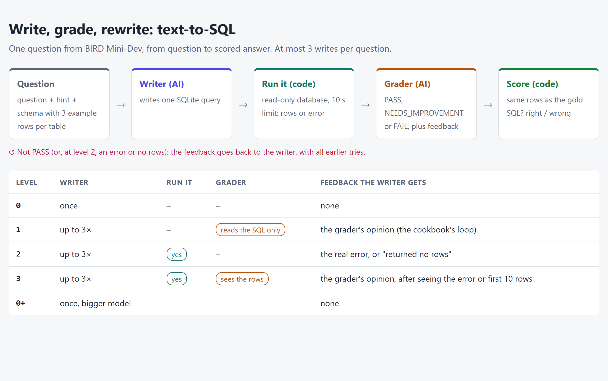

Asking a model to check its own work sounds like free quality. But a grader is just another model call. If it can't tell a right answer from a wrong one, the loop only adds cost, or worse, talks a right answer into a wrong one.

That loop is the whole idea of Anthropic's cookbook page [Evaluator-optimizer](https://platform.claude.com/cookbook/patterns-agents-evaluator-optimizer): one AI writes an answer, a second AI grades it, and the first one rewrites until the grade is PASS. The page never measures whether the grade is right. So I put the grader on trial, on a job where "right" can be checked: SQL.

## Write, grade, rewrite

The pattern has three parts:

1. **A writer** produces an answer.
2. **A grader** checks it and answers **PASS**, **NEEDS_IMPROVEMENT** or **FAIL**, with feedback.
3. If it isn't PASS, the writer gets its earlier tries and the feedback, and writes again. The loop runs until PASS.

The page says this fits best when there are clear grading rules and rewriting adds value, and it names two signs of a good fit: answers get clearly better with feedback, and the model can give useful feedback itself.

The idea: **let a model check its own work, and you get better answers.**

The evidence: **one example**, a small code class (a stack that also tracks its minimum). The grader **reads** the code; nothing is run or tested. Its first feedback was about extras (error handling, type hints, comments), and the page stops after the second try, so we never see a PASS. The loop has no round limit, and there are no numbers.

We see the loop running. We never see whether the grade is **right**.

## The grader on trial

### Three questions

**On real text-to-SQL questions with known answers, does the write → grade → rewrite loop give more right answers than one try? When the grader says PASS, is the answer really right? And does feedback from running the SQL beat feedback from an AI reading it?**

SQL is a good test because "right" isn't an opinion: run the query, and compare its rows with the rows of the correct query.

### 120 BIRD questions

[BIRD](https://bird-bench.github.io/) is a public text-to-SQL benchmark built on real databases. Its **Mini-Dev** set has **500 questions over 11 SQLite databases** (California schools, Formula 1 results, a bank, football matches, a Q&A site and more), each with a correct query written by the dataset's authors, a short **hint** ("free-meal rate = free meal count ÷ enrollment") and a difficulty tag.

I drew two sets with a fixed seed:

- **Main set**, 60 questions from **6 databases**. I was allowed to tune on this one.
- **Held-out set**, 60 questions from the **other 5 databases**. New tables, new column names. No prompt changed once this run started.

Both have 18 simple, 30 moderate and 12 challenging questions.

### From one try to a full loop

Level 0 is a single try; each level after it changes one thing:

- **Level 0 · one try.** The model sees the schema (with 3 example rows per table), the hint and the question, and writes one query.
- **Level 1 · AI grader reads it.** The cookbook's loop: a grader **reads** the query, without running it. Up to 3 writes.
- **Level 2 · just run it.** No AI grader. Code **runs** the query; if it fails or returns no rows, the writer gets the real error and tries again. Up to 3 writes.
- **Level 3 · AI grader sees the result.** Like level 1, but the grader also sees the error or the first 10 rows the query returned.
- **Level 0+ · bigger model, one try.**
- **Levels 4 and 5 · teacher and student.** Like levels 1 and 3, but the grader is the bigger model: a small student writes, a big teacher grades. I added these **after** seeing the first results (see result 8).

Levels 0–3 use `gpt-6-luna` (small and cheap) for both writer and grader. Level 0+ uses `gpt-6.1-sol`. Levels 4 and 5 write with `gpt-6-luna` and grade with `gpt-6.1-sol`. Each level ran 3 times.

The cookbook's grader checks code for correctness, speed and style. For SQL only correctness matters, so my grader checks the tables, joins, filters, columns and the use of the hint.

## Right, fixed, broken

| What I measure | In plain words |
|---|---|
| ✅ **Right** | The query returns the same rows as the correct query (BIRD's rule: same set of rows, order ignored) |
| 1️⃣ **First try right** | The same, for the first query the writer wrote. The gap to "right" is what the loop added |
| 🔧 **Fixed** / 💥 **Broken** | The loop turned a wrong first try right / a right first try wrong |
| 🎭 **PASS on wrong** | The grader said PASS to a wrong query |
| 🚨 **False alarm** | The grader asked to change a query that was already right |
| 🔁 **Rounds** | How many writes a question took, and how often it hit the cap of 3 |
| 💰 **Cost and time** | Dollars and seconds per question |

**What Anthropic's page suggests:** a model can give useful feedback on its own work, and the answers get better.

**What I expected** (my guesses before running anything):

- **Level 1 barely helps.** A grader that only reads SQL can't see the data, so it will PASS many wrong queries.
- **Level 2 fixes the queries that don't run**, but not wrong logic.
- **Level 3 helps most**, because the grader sees real rows.
- **The bigger model might beat all of them**, like it did in topics 01 and 02.
- **Some right answers will get broken** by a grader asking for "improvements".

## What the loop actually did

Two sets, seven levels, three repeats each. The whole topic, smoke runs and a discarded buggy run included, cost **$3.83**. The full tables are in [`results.md`](https://github.com/hakmimi/ai-engineering-lab/blob/main/topics/05-evaluator-optimizer-text-to-sql/results.md).

### 1 · The loop didn't make more answers right

| Level | Main: right | Held-out: right |
|---|---|---|
| 0 · one try | 54% | 59% |
| 1 · AI grader reads it | 54% | 58% |
| 2 · just run it | 56% | 61% |
| 3 · AI grader sees the result | 52% | 59% |
| 0+ · bigger model, one try | 57% | **71%** |
| 4 · small writes, big grades (reads) | 52% | 59% |
| 5 · small writes, big grades (sees rows) | 56% | 59% |

On both sets, levels 1 to 5 land within **2 points** of one try. With 60 questions, one question is about 1.7 points, so that's one question either way: noise.

Only **two things moved the number at all**: running the query (level 2, **+2 points** on both sets, and it never broke a right answer), and a bigger model (**+12 points** on the held-out set).

### 2 · The grader said PASS to almost every wrong answer

This is the core of the cookbook's claim: *the model can give useful feedback on its own work.* Here is how often the grader said PASS to a query that was wrong:

| | Main | Held-out |
|---|---|---|
| Level 1 · grader reads the SQL | 87% | **94%** |
| Level 3 · grader sees the rows | 81% | 82% |

So when the grader said PASS, the answer was right only **53–59%** of the time (54% and 57% at level 1, 53% and 59% at level 3). That's the writer's own hit rate. **The PASS added no information.**

Seeing the rows helped a little. On the held-out set, the level 3 grader flagged 16 of the 78 wrong first tries, and **6** of those ended right. The level 1 grader flagged 4 of 75 and fixed **none**.

### 3 · And it asked to change right answers

The other way to fail is a **false alarm**: the grader asks to change a query that was already right. That happened on **3–7%** of right queries on the main set, and **11–14%** on the held-out set. Across 3 repeats, the grader loops **broke** 1 to 3 right answers per level. Level 2, which has no AI grader, broke **none**.

### 4 · One question tells the whole story

**Q758** (held-out): *"Provide the hair colour of the human superhero who is 185 cm tall."* The hint says `race = 'human'`. The database stores `Human`, with a capital H, and SQLite compares text case by case.

- **Level 1.** In one repeat, the writer wrote `'Human'`, which was right. The grader **read** the query, compared it with the hint, and asked for `'human'`. The writer obeyed. **Right became wrong**, and the grader said PASS.
- **Level 2.** The writer used `'human'`, the query returned **no rows**, and that fact alone made it try again with a case-blind match. **Wrong became right.**
- **Level 3.** Same as level 2: the grader saw "0 rows", guessed the capital letter, and the next try was right.

A grader that only reads can't see the data. It can only check the query against the text, and here the text was wrong.

### 5 · Many "broken" answers are the grader disagreeing with the answer key

I read every answer the loop broke. Most weren't silly. They were the grader enforcing a **reasonable reading** that the dataset's correct query doesn't share:

- **Q72** (main): *"How many students… are enrolled at the State Special School in Fremont?"* The correct query returns **two rows**, one per school. The grader saw two numbers, said "How many asks for one answer", and the writer **summed** them. A fair point, and wrong by BIRD's rule.
- **Q604** (main): the hint says average = `SUM(UpVotes) / COUNT(UserId)`. The correct query uses `AVG()`, which skips empty values. The grader insisted on the hint's formula. Different numbers, so wrong.
- **Q412** (held-out): `types = 'Creature'` misses cards that are *also* another type, and the grader said so. The correct query uses `= 'Creature'`.

So the loop doesn't move answers toward **right**. It moves them toward **what the grader thinks is right**. When the grader and the answer key disagree, the key wins the score.

### 6 · The strict rule costs 2–7 points, the same at every level

BIRD calls an answer right only if it returns exactly the same rows. A query that also shows an extra column (say, the school name next to the number) counts as wrong. I added a lenient score that forgives extra or reordered columns:

| Level | Main: strict → lenient | Held-out: strict → lenient |
|---|---|---|
| 0 | 54% → 61% | 59% → 62% |
| 1 | 54% → 61% | 58% → 62% |
| 2 | 56% → 62% | 61% → 64% |
| 3 | 52% → 59% | 59% → 61% |
| 0+ | 57% → 59% | 71% → 71% |
| 4 | 52% → 58% | 59% → 62% |
| 5 | 56% → 62% | 59% → 63% |

The gap is the same for levels 0 to 3, so **it doesn't change the story**. The small model gains more from it than the bigger one (6–7 points against 2 on the main set), so extra columns explain part of their tie there. Even forgiven, levels 0–3 stay within 3 points of each other.

### 7 · The loop doubled the time and cost, for nothing

| Level | Seconds / question | $ / question |
|---|---|---|
| 0 · one try | 5.2–5.4 | $0.00017–0.00019 |
| 1 · grader reads | 10.9–11.4 | $0.00037–0.00042 |
| 2 · run it | 5.9–6.3 | $0.00018–0.00023 |
| 3 · grader sees rows | 12.2–13.2 | $0.00043–0.00049 |
| 0+ · bigger model | 4.2–4.4 | $0.00168–0.00191 |
| 4 · big grades, reads | 8.2–8.4 | $0.00124–0.00132 |
| 5 · big grades, sees rows | 8.7–9.5 | $0.00129–0.00150 |

The grader loops took **twice as long** and cost **twice as much** as one try. Running the query was almost free. The bigger model costs about **10×** per question, and it was also the fastest.

The cap barely mattered: almost every question ended with a PASS, and only 0 to 3 of 180 per level hit the cap of 3.

### 8 · A bigger teacher didn't help either

After the first results, the obvious question was: *what if the grader is smarter than the writer?* Like a student and a teacher. So I added two levels: the small model writes, the big model (`gpt-6.1-sol`) grades, either reading the query (level 4) or also seeing the rows (level 5). Same prompts, nothing else changed.

| | Main: right | Held-out: right | PASS on wrong (main / held-out) |
|---|---|---|---|
| 0 · student alone | 54% | 59% | – |
| 1 · student grades itself | 54% | 58% | 87% / 94% |
| 4 · teacher grades, reads | 52% | 59% | **90% / 94%** |
| 5 · teacher grades, sees rows | 56% | 59% | **85% / 91%** |
| 0+ · teacher writes alone | 57% | **71%** | – |

The teacher said PASS to wrong queries **as often as the student did**. On the held-out set it flagged only 5 of 74 wrong first tries at level 4, and 7 of 76 at level 5. It was more polite to right answers (false alarms dropped to 1–8%), but it caught almost nothing.

**Why?** The teacher barely looked. Its typical grade was **5 output tokens**, usually just the word `PASS`. The small grader wrote about 165. The same big model that gets 71% when it writes the query, says "looks fine" to a wrong one when it only checks it.

And it wasn't cheap: **$0.0012–0.0015 per question**, about 7× one try and three-quarters of the cost of the big model writing alone, which was **12 points better** on the held-out set. I also checked that the teacher didn't just hand over the answer: **none** of its feedback contained a full query.

So if you're going to pay for the big model, **pay it to write, not to grade.**

### What I expected vs. what happened

| My guess before running | What happened |
|---|---|
| Level 1 barely helps; a reading grader PASSes wrong queries | ✅ +0 points, and it PASSed 87–94% of wrong queries |
| Level 2 fixes the queries that don't run, not wrong logic | ✅ +2 points, only errors, timeouts and empty results; never broke a right answer |
| Level 3 helps most, because the grader sees real rows | ❌ It flagged more, but broke about as many as it fixed: −2 and +0 points |
| The bigger model might beat all of them | ✅ on held-out (+12 points), ❌ a tie on main |
| *(added later)* A bigger grader would catch more | ❌ It PASSed 85–94% of wrong queries, like the small one |
| Some right answers will get broken | ✅ 1–3 per level, mostly where the grader and the answer key disagree |

## Trust the rows, not the grade

- **A grader is only as good as what it can check.** Reading a query, the grader agreed with the writer about 9 times in 10, wrong or not. Its PASS told me nothing the first try didn't.
- **Run it before you judge it.** The only feedback that helped for free was the database's own: an error, a timeout or "no rows". It fixed a few answers and broke none.
- **Showing the grader the result is not enough.** At level 3 it caught more mistakes, and talked about as many right answers into wrong ones.
- **The loop pulls toward the grader's opinion, not the truth.** When the hint, the grader and the answer key disagree, the loop picks the grader.
- **Check the cookbook's two conditions before using the pattern.** "Answers improve with feedback" and "the model can give useful feedback" both failed here. On a job you can test with code, test with code.
- **A smarter grader is not a better grader.** The big model as a teacher PASSed wrong queries as often as the small one, and mostly answered with one word.
- **For more right answers, a bigger model beat every loop.** +12 points on the held-out set, at 10× the cost per question but still under a fifth of a cent. Using it as a writer beat using it as a grader.

## What this doesn't show

- **Not Claude.** The writer and grader are `gpt-6-luna`, and level 0+ is `gpt-6.1-sol`, like the rest of this series. A Claude model may grade differently.
- **Levels 4 and 5 were added after the first results.** They use the same prompts and code paths as levels 1 and 3, only the grader model changes, and they ran on both sets. Still, they weren't in the original plan.
- **The teacher wasn't pushed to think.** At default reasoning effort it mostly answered with one word. A teacher told to write its own query first and then compare might do much better. That would be a new prompt, so I didn't try it here.
- **60 questions per set is small.** One question is about 1.7 points. Differences of 2–3 points between levels 0 to 3 are within noise.
- **BIRD's answer key has quirks.** Some correct queries return two rows where the question asks for one number, and some hints don't match the data (Q758). That hurts every level, but it especially hurts a grader that trusts the hint.
- **One grader prompt.** Mine checks tables, joins, filters, columns and the hint. A prompt that also says "trust the data over the hint" might do better. I didn't tune it, on purpose, to stay close to the cookbook.
- **Default reasoning effort.** Same as topics 01 and 02. More thinking might make a better grader.
- **SQL is a strict job.** The cookbook's example is code style, where "better" is a matter of taste. This test doesn't say the pattern fails there; it says the grader's PASS shouldn't be trusted where right and wrong can be checked.

**Data credit.** Questions, hints and correct queries come from **BIRD Mini-Dev** (the BIRD-SQL team), CC BY-SA 4.0. See [`data/NOTICE.md`](https://github.com/hakmimi/ai-engineering-lab/blob/main/topics/05-evaluator-optimizer-text-to-sql/data/NOTICE.md) for what I took and changed.

## Inside the code

### Getting BIRD cheaply

- **Source:** `minidev.zip` from BIRD's official link (801 MB). I only needed the SQLite part, so I fetched **only the files I needed** with HTTP range requests (about 346 MB): the 500 questions, the table list and the 11 SQLite databases. The MySQL and PostgreSQL copies were never downloaded.
- **How I drew the sets:** split the 11 databases 6 / 5 with a fixed seed (2026), then drew 18 simple, 30 moderate and 12 challenging questions from each group. Every correct query was run first (read-only, 30 s limit); none failed.
- **What the model sees:** each table's `CREATE TABLE` text, 3 example rows per table (long cells cut at 60 characters), the hint and the question. Never the correct query, its rows or the difficulty tag.

### Tools

| Tool | What I used it for |
|---|---|
| **Python 3** | Everything |
| **SQLite** (Python's built-in `sqlite3`) | Running every query, **read-only**, with a 10 s limit (30 s for the correct queries) |
| **OpenAI API**, `gpt-6-luna` / `gpt-6.1-sol` | Writer and grader, through the shared helper ([`shared/llm.py`](https://github.com/hakmimi/ai-engineering-lab/blob/main/shared/llm.py)) that counts tokens, time and cost |
| **BIRD Mini-Dev** | Questions, hints, correct queries, databases |
| **pytest** | Offline tests; a shared fixture blocks every real API call |
| **Claude Code** | My pair programmer: design, plan, code and analysis |

### The run, step by step

1. `build_data.py` splits the databases, draws the two sets and writes `data/main.json` and `data/test.json`.
2. `schema.py` builds the schema text the writer sees.
3. `levels.py` runs one question at one level: write, run, grade, rewrite, at most 3 writes. Every round is saved: the query, its error, the row count, the grader's verdict and feedback.
4. `run.py` prints a cost estimate, stops at a budget, and refuses to go past **$10** for the whole topic. Every run is saved as a file.
5. `score.py` compares each query's rows with the correct query's rows. `lenient.py` adds the "extra columns forgiven" score.
6. `report.py` builds `results.md` **from the run files only**. No number is typed by hand.

### Tests

Free offline tests cover the places where a bug would change a score without crashing:

- **The database can't be changed:** an `INSERT` fails, and a slow query stops at the time limit.
- **Fair comparison:** row order and duplicates don't matter, and binary values compare the same on both sides.
- **No leaks:** the two sets never share a database, and the draw is the same every time.
- **The loop does what it says:** level 0 makes one call; levels 1 and 3 stop on PASS and at 3 writes; level 2 never calls a grader; level 3's grader really gets the rows; each rewrite sees all earlier tries.
- **Reading the answers:** SQL inside tags or code fences is found, an unknown verdict stops the loop and is counted, and HTML-escaped symbols are turned back into SQL.
- **Fair scoring:** an API outage is left out of the score and counted on its own.
- **Scoring counted by hand:** fixed, broken, PASS on wrong and false alarm on small made-up runs.
- **Money:** a dry run makes no calls, and a run over budget or over the topic limit is refused.

### Bugs that changed the numbers

- **The model escaped its own SQL.** In my first main-set run, the writer sometimes wrote `&gt;` instead of `>` inside the `<sql>` tag, as if writing HTML. SQLite read that as a column named `gt`. **38 rounds** across the first runs had it, and at levels 2 and 3 the loop spent its rewrites fixing *my* glue, not the SQL. A test now covers it, the code un-escapes the text, and I re-ran the whole main set. The bad runs are kept in `runs/superseded/`, and the new runs have **0**.
- **Read the wrong answers before trusting the score.** In the smoke run, many "wrong" queries were right in spirit: same numbers plus an extra column. That's why I added the lenient score next to BIRD's rule instead of replacing it.
- **A new model, a new format.** In the first teacher run, the big model answered just `PASS`, with no tags. My code counted that as unreadable and stopped the loop, in **93%** of the questions. A test now covers bare verdicts, the code accepts them, and I re-ran both teacher levels. The bad run is kept in `runs/superseded/`. Levels 0–3 never had an unreadable grade, so their numbers didn't change.
- **Check what "broken" means.** Reading every broken answer showed the pattern in result 5: the grader wasn't careless, it just had its own idea of right.

### Where to find it

Source: [ai-engineering-lab / 05-evaluator-optimizer-text-to-sql](https://github.com/hakmimi/ai-engineering-lab/tree/main/topics/05-evaluator-optimizer-text-to-sql). It has the seven levels, the offline tests, the design and plan, the drawn question sets, and a results file built only from real runs.
