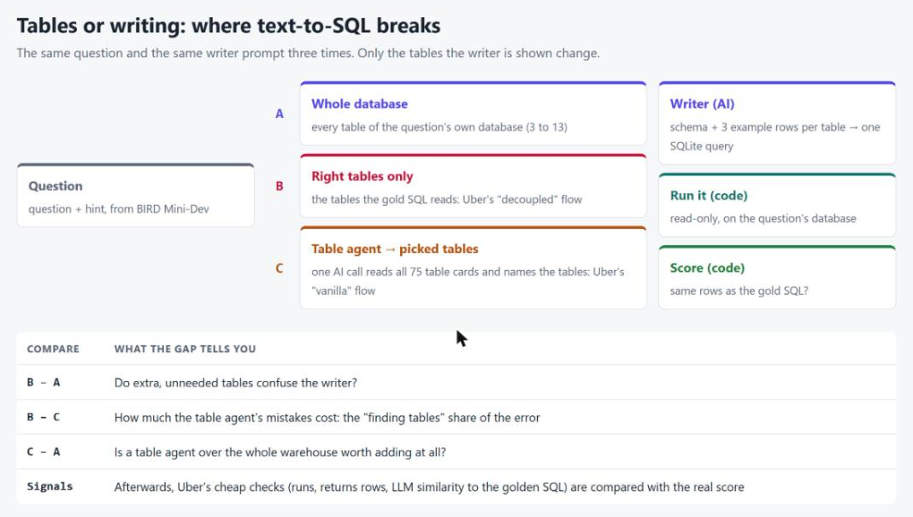
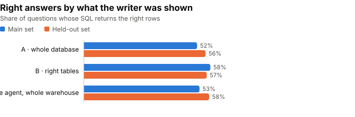
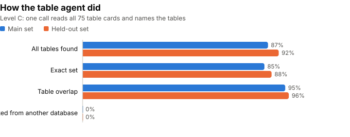
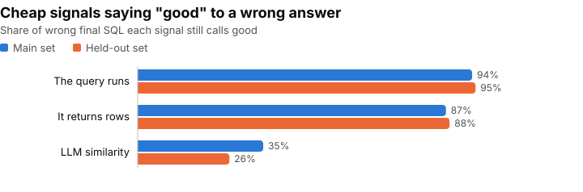

Picture two copies of the same text-to-SQL bot. One has to find the right tables on its own. The other gets them handed over on a plate. The difference in how often they're right is exactly what table search costs you.

Uber describes this test in their write-up of [QueryGPT](https://www.uber.com/lb/en/blog/query-gpt/), their tool for turning plain-English questions into SQL. They run both copies. They just never print the numbers. So I ran it myself, on questions where the right answer is known.

## Why everyone builds a table finder

QueryGPT is a chain of small agents: an **intent agent** picks a business area, a **table agent** proposes tables (the user can fix them), a **column-prune agent** trims wide tables, and only then is the query written. LinkedIn and Pinterest built the same kind of step, which I tested in my [last post](/Blog/posts/text-to-sql-table-retrieval/). The shared belief: the model can write SQL fine, it just gets lost in a big warehouse.

To check their system, Uber keeps a set of questions, each with a "golden" query, and runs two flows:

- **Vanilla:** the system finds the tables and writes the query. This is the real product.
- **Decoupled:** the system is **given the right tables** and only writes. A stand-in for a person fixing the tables first.

For each question they log: did the intent match, how many of the right tables were picked (**table overlap**), did the query **run**, did it **return rows**, and an **LLM score** of how similar it is to the golden query.

Two things in there deserve numbers:

1. **Vanilla vs decoupled** splits the error in two: finding tables vs writing SQL.
2. **None of the logged signals is "the answer is right".** Runs, has rows and LLM similarity are cheap stand-ins. How good are they?

## My bets, before running anything

- Handing the writer only the right tables helps **a few points**. BIRD databases are small (3–13 tables), so there's not much to get lost in.
- A table agent over the whole warehouse finds every right table **85–90%** of the time, and lands **close to the plain baseline**.
- So at this size, most of the error is **writing**, not finding tables.
- "Runs" and "returns rows" say **good to most wrong answers**. The LLM score does better, but still passes a fair share of them.

## One warehouse, three ways to see it

### The questions

The same 60 + 60 questions I used in the [grader post](/Blog/posts/evaluator-optimizer/), from [BIRD](https://bird-bench.github.io/) Mini-Dev: real SQLite databases (schools, Formula 1, a bank, hospital lab tests, football and more), each question with a hint and a correct query written by the dataset's authors. The **main set** (6 databases) is where I looked and set things. The **held-out set** (5 other databases) ran once at the end, with nothing changed.

### A small warehouse

I put **all 75 tables** of the 11 databases in one list (798 columns), each named `database.table`. That's the haystack for the table agent.

For each question I also needed the tables its correct query **reads**. I didn't parse the SQL for this. SQLite can report every table a query touches while it prepares it (an "authorizer" hook), so the list is exact.

### Three levels

The writer prompt is the same every time. Only the tables it is shown change:

| Level | The writer is shown | Uber's name | AI calls |
|---|---|---|---|
| **A · whole database** | every table of the question's own database | (BIRD's usual setup) | 1 |
| **B · right tables** | only the tables the correct query reads | decoupled | 1 |
| **C · table agent** | the tables an agent picked from all 75 | vanilla | 2 |

For each table the writer gets its `CREATE TABLE` and 3 example rows. The table agent gets a one-line card per table: name, columns and types.

## What counts as right

| What I measure | In plain words |
|---|---|
| **Right** | The query returns the same rows as the correct query (BIRD's rule) |
| **B − A** | Do extra tables confuse the writer? |
| **B − C** | What the table agent's mistakes cost |
| **C − A** | Is a table agent over the whole warehouse worth adding? |
| **All found** | Level C: the agent picked every table the correct query reads |
| **Signals** | How often "runs", "returns rows" and the LLM score say "good" to a wrong answer, and to a right one |

The writer, the agent and the similarity judge are all `gpt-6-luna`. Each level ran 3 times on each set. The judge's "good" line (a score of 0.9 or more) was picked on the main set and kept for the held-out set.

## The tables were rarely the problem

Everything below comes from the run files. The whole topic, smoke run included, cost **$0.41**. Full tables are in [`results.md`](https://github.com/hakmimi/ai-engineering-lab/blob/main/topics/07-text-to-sql-where-it-breaks/results.md).

| Level | Right, main | Right, held-out |
|---|---|---|
| A · whole database | 52% | 56% |
| B · right tables | 58% | 57% |
| C · table agent | 53% | 58% |

| Gap | Main | Held-out |
|---|---|---|
| B − A (extra tables) | +6 | +1 |
| B − C (agent's mistakes) | +5 | −1 |
| C − A (agent worth it?) | +1 | +2 |

### The right tables on a plate barely helped

On the main set, level B looked like a real win: **+6 points** over the whole database. On the held-out set it was **+1**. One question is worth about 1.7 points, and repeats of the same level moved by up to 7 points, so neither number is a clear effect. Even with the right tables in hand, the writer was **wrong on 42–43% of questions**.

### The agent was good at its job

Reading all 75 cards in one call, the agent picked every right table in **87%** (main) and **92%** (held-out) of the questions, and the exact set in 85% and 88%. It **never picked a table from the wrong database** and never made up a name.

When it did miss a table, the answer was almost always wrong: **12%** right on main, **0%** on held-out. A miss costs a lot, but misses were rare.

Level C ended up **level with A and B** on both sets. The extra step neither paid off nor hurt. It only added a call: **8.0 vs 4.9 seconds** per question on main, and about 60% more cost (still a fraction of a cent).

### Three of four wrong answers had every table

This is the real answer. Counting level C's wrong answers over all repeats:

| | Main | Held-out |
|---|---|---|
| Wrong answers | 84 | 76 |
| …with every right table picked | 63 (**75%**) | 61 (**80%**) |
| …with a table missing | 21 | 15 |

Most mistakes were **writing mistakes**, not search mistakes. And **20–21 questions per set were wrong at every level in every repeat**. For those, the tables didn't matter at all.

Two misses on the main set show why "the right tables" is fuzzy. For a Formula 1 question about drivers "and the lap number", the agent picked `lapTimes`; the correct query gets it from `results`. For "the patient with the highest hemoglobin at the time of the examination", it added `Examination`, the writer used it, and the answer went wrong. Both are picks a person might make from the question.

### "It runs" says yes to almost everything

| Signal | Says "good" to a wrong answer (main / held-out) | Says "good" to a right answer |
|---|---|---|
| The query runs | 94% / 95% | 100% / 100% |
| It returns rows | 87% / 88% | 100% / 100% |
| LLM similarity ≥ 0.9 | 35% / 26% | 89% / 88% |

The two cheap checks are **close to useless as a quality measure**: nearly every wrong query runs and returns rows. They only catch broken SQL.

The LLM score does much better. On the held-out set it **flagged three of four wrong answers** and kept 88% of right ones. But it still called **60 wrong answers out of 233** "the same as the golden query". A useful filter, not a replacement for comparing rows.

### My bets vs. the runs

| I expected | What happened |
|---|---|
| B beats A by a few points | +6 on main, **+1 on held-out**: not a clear effect |
| The agent finds all tables 85–90% of the time | **87% / 92%** ✓ |
| C lands close to A | **+1 / +2** ✓ |
| Most of the error is writing | **75–80%** of wrong answers had every table ✓ |
| "Runs" / "has rows" pass most wrong answers | **87–95%** ✓ |
| LLM similarity does better, still passes a fair share | **26–35%** ✓ |

## So, is it the tables?

- **Not at this size.** On 75 tables across 11 clearly different databases, one AI call finds the right tables about 9 times in 10. What's left is mostly the writer getting the SQL wrong with the right tables in front of it.
- **Uber's split is the right tool.** Running "given the right tables" next to "find them yourself" took one extra level and answered the question directly. Any team can run it on their own warehouse.
- **Don't grade with "it runs".** If your eval logs only "runs" and "has rows", most wrong answers look fine. Keep questions with known answers and compare rows.
- **An LLM similarity score is a decent cheap filter**, but set its line on data with known answers, and don't trust it alone.
- **The companies may still be right, at their scale.** In my [last post](/Blog/posts/text-to-sql-table-retrieval/), on 971 look-alike tables, search was the weak link. Here, on 75 very different ones, it wasn't. Measure your own warehouse before you decide where to spend.

## Before you quote these numbers

- **75 tables is not Uber's warehouse.** Uber, LinkedIn and Pinterest talk about many thousands of tables. Here the 11 databases are on very different topics, so the right area is easy to spot.
- **The names help.** Every table carries its database (`formula_1.races`). Clean names make the agent's job easier.
- **The right set of tables isn't always unique.** In one smoke-run question about charter school funding, the agent picked `schools` instead of `frpm`. Both tables have a funding-type column, so its query could have worked. It still counts as a miss.
- **One model, low effort.** Writer, agent and judge are all `gpt-6-luna`. A stronger writer might shift the balance toward tables.
- **60 questions per set.** One question is about 1.7 points. Gaps of 1–2 points are noise.
- **No column pruning, no intent agent.** Left out on purpose: the question here is tables vs writing.
- **Two held-out levels ran twice by mistake.** Levels B and C were run a second time on the held-out set by accident, minutes after the first runs. Only the first runs are reported. The extra runs are set aside and never used, but their $0.08 is in the total cost.

**Data credit.** Questions, hints, correct queries and databases come from **BIRD Mini-Dev** (the BIRD-SQL team), CC BY-SA 4.0. See [`data/NOTICE.md`](https://github.com/hakmimi/ai-engineering-lab/blob/main/topics/07-text-to-sql-where-it-breaks/data/NOTICE.md).

## The parts and the tests

### The parts

| File | What it does |
|---|---|
| `gold_tables.py` | Prepares each correct query in SQLite with an authorizer hook and records every table it reads |
| `warehouse.py` | Loads all 75 tables, renders the agent's one-line cards and the writer's schema blocks |
| `agent.py` | The table agent: one call over all cards, returns `<tables>`; drops made-up names and counts them |
| `levels.py` | Levels A, B, C: decide which tables the writer sees, then call the writer from the grader post |
| `judge.py` | Uber's LLM similarity, 0 to 1, run after the levels on stored SQL; each distinct query judged once |
| `run.py` | Cost estimate first, budget stop per command, $10 ceiling for the topic |
| `report.py`, `charts.py` | Build `results.md` and the charts from the run files only |

The writer, its prompt, the read-only SQL runner and the row comparison are **imported from the grader post's code**, so level A here is the same thing as its level 0.

### The tests

38 offline tests, no API calls, on small SQLite databases made inside the tests:

- **Right tables:** the authorizer finds both tables of a join and tables inside subqueries, keeps SQLite's own spelling, and never runs the query.
- **The agent's answer:** odd spelling (quotes, brackets, case) is read, duplicates are dropped, a made-up name is counted, not guessed.
- **Levels:** A shows exactly what the grader post's level 0 showed, B only the right tables, C only what the agent picked. If the agent's call fails, the writer is never called.
- **Scoring:** an API outage is counted, not scored wrong; a table from another database is counted.
- **Signals:** the judge's line is picked on main, ties go to the higher one, unreadable scores are left out.
- **Money:** a dry run makes no calls; a run over budget or over the topic ceiling is refused.

### One thing that saved money

The agent reads the same 75 cards on every call, so I put them first, as a fixed system message. OpenAI caches a repeated prompt start automatically, and level C cost a fraction of my first estimate.

### The code

On GitHub: [ai-engineering-lab / 07-text-to-sql-where-it-breaks](https://github.com/hakmimi/ai-engineering-lab/tree/main/topics/07-text-to-sql-where-it-breaks), with the three levels, the table agent, the judge, the offline tests, the design and plan, and a results file built only from real runs.
